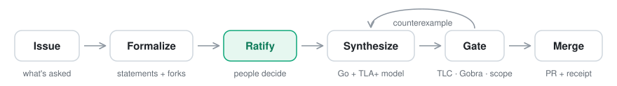
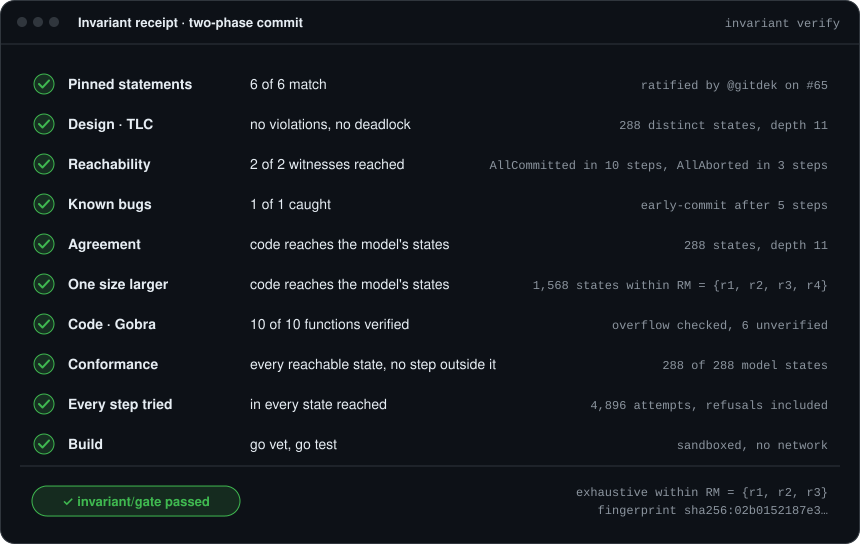

<p align="center">
  <picture>
    <source media="(prefers-color-scheme: dark)" srcset="docs/brand/logo-animated-dark.svg">
    
  </picture>
</p>

<p align="center">
  <strong>A code factory that doesn't guess.</strong><br>
  You ratify what must be true. Invariant proves every pull request against it before merging.<br>
  <a href="https://invariant.puglisij.com/"><strong>See the live dashboard →</strong></a>
</p>

<p align="center">
  
  
  
  
  
</p>

<br>

AI coding agents don't ask clarifying questions. They pick an interpretation and ship it with total confidence. Formal verification alone doesn't fix that. A proof only shows the code matches the property someone wrote down, and if the agent wrote that property, the proof just certifies the agent's guess.

Invariant splits the work where it belongs:

| People decide | Invariant proves |
| :-- | :-- |
| What must always be true: invariants, safety properties, and the bounds they're checked at | That the code satisfies them, using a model checker for the design and a verifier for the code |
| Every fork the factory can't resolve on its own | Only what it was asked to prove. Ratified statements are pinned, and the factory can't edit them |

<p align="center"><a href="#try-it"><strong>Try it</strong></a> in a minute · <a href="#use-it-on-your-repository"><strong>Use it on your repository</strong></a></p>

## How it works

<picture>
  <source media="(prefers-color-scheme: dark)" srcset="docs/assets/how-it-works-dark.svg">
  
</picture>

1. **Formalize.** Invariant drafts the properties an issue implies. Writing a formal spec forces every ambiguity into the open. You can't model a buffer, for example, without deciding what happens when it's full.
2. **Ask.** When Invariant hits a fork it can't resolve, it posts the question back on the issue as a decision request. It doesn't pick an answer for you.
3. **Ratify.** A person approves each statement. The approval is recorded along with where the statement came from, and the statement is pinned by hash.
4. **Synthesize.** Invariant writes the implementation, in Go, TypeScript or Python, and the TLA+ model. It keeps repairing them against counterexamples until the gate passes.
5. **Gate and merge.** CI re-runs every check on the committed artifacts. The pull request merges only if every check passes.

What an issue builds or changes is a **project**: one component, such as a rate limiter, with its ratified statements, its TLA+ model and its code, in a directory with an `.invariant/` folder. The gate checks each project on its own and writes a receipt for each.

## Watch it take an issue

<p align="center">
  
</p>

This is the factory's first real issue, as it happened on GitHub. [#1](https://github.com/gitdek/invariant/issues/1) asked for a bounded buffer for log shipping and left two decisions open: what happens when the buffer is full, and what happens when a send fails. Invariant didn't choose. It asked, drafted 13 statements with @gitdek's answers, and had TLC check them against a draft model before anyone was asked to ratify them. After @gitdek ratified, it wrote the code, proved it with Gobra, and opened [#2](https://github.com/gitdek/invariant/pull/2). It merged #2 itself once CI's gate passed on that exact commit.

People steer the factory with comments on the issue, and only people with write access are heard:

| On the issue | What happens |
| :-- | :-- |
| `/invariant solve`, or the `invariant` label | The factory takes the issue |
| `/invariant choose F1 A` | Decides a question the factory asked |
| `/invariant revise` | The factory drafts again, reading the comments |
| `/invariant ratify <hash>` | Ratifies exactly the proposal with that hash, and the factory carries it out |
| The `invariant:go`, `invariant:typescript` or `invariant:python` label | The factory writes the code in that language. Without one, the repository's default applies: Go here |
| A `Project: <dir>` line in the issue | Changes that existing project. The factory proposes a diff of its statements, and calls out anything removed or loosened |
| An `Agent: codex` or `Agent: claude-code` line in the issue | Picks the coding agent that drafts and builds the issue. A new project's manifest records it for the project's later issues. Without either, the factory's own agent does |
| `Code: <path>` lines in the issue | Checks existing TypeScript code as it is, without changing a line. The factory writes only the model and a driver that runs the real code |
| A `Kind: plumbing` line in the issue | For a change that isn't a state machine. The factory proposes a plan: what changes, the files it may touch and acceptance tests, or a plan of at most 10 issues when the work won't fit one pull request. A writer ratifies it by its hash. On this repository only, for now |
| `/invariant retry` | After a failure, tries again: it builds a plan's failed draft again in a new pull request, watches any other open pull request until CI's gate passes, and builds a stopped build again. [The factory's page](docs/factory.md#retries) says which happens when |
| `/invariant plan` | On an issue that holds or links a PRD, the factory proposes a plan of at most 10 issues in place of statements. Once a writer ratifies it, the factory opens the plan's issues one at a time, each once the one before has merged, and takes each on that writer's authority |
| `/invariant stop` | On a ratified plan's issue, the factory opens no more of the plan's issues. To stop it on a pull request, close the pull request or the issue, or turn the pull request into a draft |

You can answer forks a few at a time. The factory keeps each choice and who made it across polls and restarts, and replies once for each new set of choices with the forks still unanswered. A following `/invariant revise` drafts immediately with those choices, the previous draft and your comments, even while other forks remain open.

Ratification resumes an earlier branch only when the proposal hash and any project directory named in the saved proposal match, including an amendment's target. Changing that destination starts a fresh branch from the base. A project given an automatic numbered directory keeps its earlier allocation when work resumes.

Whatever the issue, the factory never merges a change to the trusted base, the gate, its own code and its proved rules among them. A modeled project under `factory/`, such as the factory's own recovery core, waits for a person to merge it, as a plan's change to the trusted base does ([D-0109](decisions/journal/D-0109.jsonl), [D-0248](decisions/journal/D-0248.jsonl)).

For plumbing, the factory builds the plan in a sandbox with no network. It runs formatting, vet, the tests of every package the change touches and the plan's acceptance tests, then has a second agent review the whole change. Review findings go back to the same builder, at most twice. Only passing checks and an approving review make a ready pull request; anything else stays a draft for a person. [The factory's page](docs/factory.md) has the rest: the sandbox and its budgets, retries, what a build may write, provider failures, merger work and plans of issues.

If GitHub refuses one of the factory's steps outright, such as opening a pull request, the factory quotes GitHub's answer once on the issue and waits for a writer's `/invariant retry`. Closing an issue stops its work: the factory records the close once, and a person's merge of its pull request, even one after the close. [The factory's page](docs/factory.md#recovery) says how.

Anyone can open an issue, but the factory takes one only when a writer labels it, or says `/invariant solve` or `/invariant plan`. That hands the issue's text to a coding agent, so read someone else's issue before you do. The agent that drafts statements has no network and no GitHub access, and nothing it drafts is built until a person ratifies it.

## Watch it catch a bug

<p align="center">
  
</p>

Passing TLC only means something if the invariants could have failed. So the gate plants known bugs in the model and requires TLC to catch each one. This is the real counterexample for the two-phase commit example's planted bug: a coordinator that commits after hearing from one resource manager instead of all three. TLC finds the shortest path to an inconsistent commit. In five steps, r2 aborts on its own, the coordinator commits anyway on r1's vote alone, and r1 commits.

## One action, one contract

<p align="center">
  
</p>

The factory owns both the model and the code, and each Go method's contract restates exactly one TLA+ action. The code refuses a step the model can't take, by itself, so its contract says both outcomes. `ok` holds exactly when the action's enabling condition held. A step it takes has the action's effect, a refusal changes nothing, and nothing else ever changes. Sending the action's message is the caller's job, since messages belong to the environment. TLC checks the model, Gobra proves the code at every size, and the gate explores the code to confirm that both reach the same 288 states.

## The gate

| Check | Tool | Fails when |
| :-- | :-- | :-- |
| Pins | Invariant | A ratified statement's text, or anything it depends on, has changed |
| Design | TLA+ · TLC | An invariant is violated, or the system can deadlock, within the ratified bounds |
| Design at every size | TLAPS | A ratified invariant the project selects for TLAPS isn't proved of the model at every size, or its proof leans on something the gate refuses |
| Reachability | TLA+ · TLC | A ratified witness can't be reached, so the invariants might hold only because nothing happens |
| Liveness | TLA+ · TLC | A ratified property, such as "every command is eventually answered", doesn't hold under the ratified fairness, or a fairness statement isn't about a step the model takes |
| Known bugs | TLA+ · TLC | A ratified bug, added to the model as an extra action, slips past the invariants |
| Agreement | Invariant | Go: the code, explored from its initial state, doesn't reach exactly the states TLC found in the model |
| One size larger | Invariant · TLC | One size past the ratified bounds, the code doesn't reach exactly the states TLC finds there, so it carries a bound |
| Conformance | Invariant · TLC | Go, TypeScript and Python: the real code, driven through its operations, takes a step the model doesn't allow |
| Every step tried | Invariant · TLC | A driver, or a Go explorer that records its attempts, never tried a step in a state it reached, except where only the environment's bounds rule it out |
| Code | Gobra · Nagini | A function doesn't verify against its contract, an index or integer operation could fail, or a Python core holds arithmetic the pinned Nagini models apart from Python, which the gate refuses before Nagini runs |
| Build | vet · tests | Anything is red. Runs in a sandbox with no network and no secrets. |
| Scope | Invariant | A factory pull request changes anything outside its one project, or a plumbing one outside its plan's files, adds a dependency, uses cgo, edits CI config, or changes a ratified lock without its own issue's ratification |
| Ratification | Invariant · GitHub | A project's lock or a plan isn't exactly the proposal a person with write access ratified on its issue, or, for a lock ratified by hand, the one a person's ratification in the journal names |

Every pull request whose gate runs carries a receipt that CI generates from tool output. It lists the states explored and the bounds they cover, the functions verified, the statement hashes, and the tool versions. The factory never writes its own receipt.

The receipt also says how far the code's evidence goes: **proved**, **tested against the model** or **unchecked**, and **proved at every size** only with a check one size larger. [The gate's page](docs/gate.md) says what earns each claim, and how a project proves a model's invariant at every size with TLAPS. [The Python page](docs/python.md) covers checking an existing Python application as it is: adopting it, exploring every state, its dependencies, the evidence for each component, trusted contracts for what it calls, and proving a function in place.

## One model, three languages

The same ratified two-phase commit, pinned by the same hashes, checked in each of the languages Invariant targets:

| Implementation | How the code is checked | Evidence |
| :-- | :-- | :-- |
| [Go](examples/02-twophase-commit) | **Proved at every size.** Gobra verifies every function against a contract that restates a TLA+ action. | The code reaches exactly the model's 288 states, and its 1,568 one size larger |
| [Go, written by the factory](examples/02-twophase-commit-synthesized) | **Proved at every size**, in the same way | Written from the ratified statements alone. It passed on its first gate run |
| [TypeScript](examples/02-twophase-commit-ts) | **Tested against the model** in every state it can reach. Its driver tries every step in every state, and TLC checks each one. | All 288 of the model's states, 4,896 steps tried, refusals included, and none outside the model |
| [Python](examples/02-twophase-commit-py) | **Proved at every size.** The factory rebuilt it on [#51](https://github.com/gitdek/invariant/issues/51) around a core Nagini verifies, 8 of 8 functions | All 288 of the model's states, no step outside it |
| [Python, proved](examples/02-twophase-commit-py-proved) | **Proved.** Nagini verifies every step function against a contract that restates a TLA+ action. | Explored completely: all 288 of the model's states, no step outside it |

The receipt always says which kind of evidence it is. Plant the early-commit bug in the TypeScript or the Python and the gate rejects it at the exact step: the coordinator commits after a single vote.

A proof goes further than any run. Plant an `rm_rcv_commit_msg` in the proved Python that commits a resource manager only if it hadn't already aborted. No run can reach that state, since a Commit is sent only once every resource manager has prepared, so the tests and conformance pass. The contract doesn't rule it out, so Nagini rejects it.

A proof is only as good as the prover's model of the language. The pinned Nagini models some of Python's arithmetic apart from CPython, and an import can let a proof rest on code nothing proved, so the gate refuses both before Nagini runs. [The Python page](docs/python.md#what-a-python-proof-may-rest-on) lists what it refuses, and why.

The factory writes all three languages itself. The log buffer @gitdek ratified on [#1](https://github.com/gitdek/invariant/issues/1) was rebuilt from the statements alone, in each language, and every version passed on its first gate run:

| The factory's log buffer | How the code is checked | Evidence |
| :-- | :-- | :-- |
| [Go](examples/03-log-buffer), merged in [#2](https://github.com/gitdek/invariant/pull/2) | **Proved.** Gobra verifies 4 of 4 functions | The code reaches exactly the model's 87 states |
| [TypeScript](examples/03-log-buffer-ts) | **Tested against the model** in every state it can reach. The driver explores the state machine completely | All 87 of the model's states, no step outside it |
| [Python](examples/03-log-buffer-py) | **Proved.** Nagini verifies 4 of 4 functions | All 87 of the model's states, no step outside it |

Then the factory took its next issue as its own bot, `invariant-code-factory[bot]`. [#3](https://github.com/gitdek/invariant/issues/3) asked for a token-bucket rate limiter in TypeScript. The bot asked two questions, drafted 12 statements with the answers, committed the ratification, wrote [the code](examples/04-api-rate-limiter), opened [#4](https://github.com/gitdek/invariant/pull/4), and merged it once CI's gate passed: 26 minutes from issue to merge. The code was tested against the model in all 6,375 of its states. After its amendments, it's tested in all 19,489. @gitdek made the two decisions and ratified; the bot did everything else.

## Watch it catch a real bug

Then Invariant went to work on code nobody wrote for it. copythis-ad is a Next.js app whose video-analysis workers claim jobs under leases, renew them, and complete their attempts. Leases can run out, stalled jobs get retried, and people cancel. An issue asked the factory to check that protocol as it is, without changing a line: `Code: src/lib`.

- **It asked instead of guessing.** A lease can run out before the recovery sweep records it, and the code, its comments and its tests didn't agree on what a person's retry should do in that window. @gitdek chose: a cancel wins, but a retry must never erase the record that the attempt may have been charged.
- **It proposed 19 statements**, checked by TLC in 1,682 states before anyone ratified them. Six were known bugs the rules must catch.
- **Its driver ran the real store,** in memory and on its own clock, in a sandbox built from the app's own lockfile, and TLC checked every step against the model. At first the driver skipped the one step the new rule was about. A review caught that before merge, and D-0059 now forbids it. Once the skip was gone, the gate caught the real code taking that step: a stalled retry canceled a possibly charged attempt and requeued the job, so nobody would ever review it.
- **The fix was one guard, in an ordinary pull request,** and then the bot merged the check. From then until copythis-ad started over, in October 2026, every pull request to it ran the real lease code against the rules @gitdek ratified.

## Watch it build itself

Then Invariant turned on itself. The rules that decide what the factory does on an issue are what make it trustworthy. They cover who can direct it, what it may ratify, and when it may merge. Until slice 7, they were ordinary Go, checked only by tests.

- **It formalized its own rules.** [#9](https://github.com/gitdek/invariant/issues/9) described the factory's issue protocol in plain language, written from the watcher's code. The factory drafted a TLA+ model of one issue, checked in 8,334 states, with five known bugs the rules must catch. One of them is a merge of a commit that's no longer the pull request's head. The statements were ratified on the issue.
- **It proved them.** The factory wrote [`factory/protocol`](factory/protocol) in Go, Gobra proved every step against its contract, and the bot merged [#11](https://github.com/gitdek/invariant/pull/11) once CI proved it again.
- **The proof caught its own author.** Wiring the watcher to the proved core, [#12](https://github.com/gitdek/invariant/pull/12), means the watcher takes a step only if the model has it. Its own tests then showed three steps it had always taken that the ratified rules didn't have: a build that stops before it opens a pull request, a build that fails its own gate, and a pull request that passes CI but can't merge.
- **It changed its rules through itself.** [#13](https://github.com/gitdek/invariant/issues/13) asked the factory to add those steps. It asked two questions, including what a writer can do after a build stops, and @gitdek answered them. Then it proposed the amendment, checked by TLC in 24,762 states. @gitdek ratified it from the dashboard's new `/act` page, the first ratification made there. The factory changed its own proved core, and CI proved it again before the bot merged [#15](https://github.com/gitdek/invariant/pull/15).
- **A person ratified the next change by hand.** [#271](https://github.com/gitdek/invariant/issues/271) asked that a writer's retry build a failed plumbing build again and replace its draft. A coding agent drafted the protocol's `Rebuild` step, checked by TLC in 25,206 states, and @gitdek ratified it as a decision, [D-0202](decisions/journal/D-0202.jsonl). A lock ratified that way holds only for the exact proposal a person's ratification in the journal names, and CI, `invariant decisions check`, the gate and the dashboard all check it ([D-0208](decisions/journal/D-0208.jsonl)). [The factory's page](docs/factory.md#how-its-rules-changed) has the rest.
- **It's learning to record its own decisions.** A plumbing pull request can't write `decisions/`, so whoever merges one records its decision by hand. [#421](https://github.com/gitdek/invariant/issues/421)'s plan has the factory do that itself. [`factory/decision-followup`](factory/decision-followup) proves the follow-up's own work, and [#428](https://github.com/gitdek/invariant/issues/428) amended the protocol to authorize it ([D-0288](decisions/journal/D-0288.jsonl), [D-0293](decisions/journal/D-0293.jsonl)). The watcher doesn't take follow-ups yet: @gitdek paused the plan after its recovery step, [#445](https://github.com/gitdek/invariant/issues/445), to put plumbing on any repository first ([D-0297](decisions/journal/D-0297.jsonl)).

## Stop it anywhere

<p align="center">
  
</p>

The watcher takes each step as a few effects on GitHub, and it can stop between any two: a crash, a restart, a laptop going to sleep. Two watchers can also run on one repository at once.

- **It modeled its own recovery.** [#23](https://github.com/gitdek/invariant/issues/23) asked the factory to prove that every effect happens exactly once, whatever stops it, and that every command is still answered. It drafted 23 statements, among them two "eventually" properties under ratified fairness, which the gate now checks.
- **It proved the core.** The factory wrote [`factory/recovery`](factory/recovery), Gobra proved it at every size, and the bot merged [#25](https://github.com/gitdek/invariant/pull/25). It took 31 minutes and $1.74 of agent spend.
- **The watcher runs on it.** It records each agent run and merge where every watcher can see them, and one watcher at a time holds a lease in a Git ref. It takes every effect only as the proved core allows ([#24](https://github.com/gitdek/invariant/pull/24), [#26](https://github.com/gitdek/invariant/pull/26)).
- **GitHub failing isn't GitHub refusing.** When GitHub fails for a moment, the factory asks again on the next poll, for up to half an hour, then says on the issue that GitHub kept failing. A refusal it says at once ([D-0266](decisions/journal/D-0266.jsonl)).
- **A retry can replace a failed draft.** For [#271](https://github.com/gitdek/invariant/issues/271), a coding agent amended the recovery model by hand, and @gitdek ratified it. A writer's retry starts a new build that replaces the failed draft, and at most one of the work's pull requests is open at a time. A test stops the watcher before each of a rebuild's 16 effects, and every time the draft is replaced once, with one merge ([D-0210](decisions/journal/D-0210.jsonl), [D-0218](decisions/journal/D-0218.jsonl)).

The test above stops the watcher before each of its effects and starts a fresh one. Every time, the issue still merges with every effect done once.

SIGTERM and Ctrl-C cancel the watcher's steps and each agent run's whole process group. The watcher waits for every step and lease renewal to stop, then relinquishes its own lease with bounded cleanup, so a successor can take it immediately.

[The factory's page](docs/factory.md#recovery) has the rest of how the watcher recovers.

## Try it

With Go 1.27.1 or later and Docker installed, run:

```bash
git clone https://github.com/gitdek/invariant && cd invariant
go run ./cmd/invariant verify examples/02-twophase-commit
```

The first run pulls about 440 MB of pinned images, and Docker must run linux/amd64 images, as Rosetta does on Apple Silicon. It prints a receipt. This is the real one for the [two-phase commit example](examples/02-twophase-commit):

<p align="center">
  
</p>

<details>
<summary>The receipt as text</summary>

| Check | Result | Evidence |
| :-- | :-- | :-- |
| Pinned statements | ✅ 6 of 6 match | ratified by @gitdek on [#65](https://github.com/gitdek/invariant/issues/65#issuecomment-5875563672), amending D-0027 |
| Design · TLC | ✅ no violations, no deadlock | 288 distinct states (1,146 generated), depth 11 |
| Reachability | ✅ 2 of 2 witnesses reached | `AllCommitted` in 10 steps, `AllAborted` in 3 steps |
| Known bugs | ✅ 1 of 1 caught | early-commit: `TCConsistent` violated after 5 steps |
| Agreement | ✅ code reaches the model's states | 288 states, depth 11 |
| One size larger | ✅ code reaches the model's states | 1,568 states, depth 14, within `RM = {r1, r2, r3, r4}` |
| Code · Gobra | ✅ proved: 10 of 10 functions verified | 10 with contracts, overflow checked, not verified: Init, load, store, mv, Try, Abstract |
| Code · conformance | ✅ tested against the model: every reachable state, no step outside it | 4,896 steps recorded, 288 of 288 model states visited |
| Every step tried | ✅ in every state reached, but where only the environment's bounds rule a step out | 4,896 attempts in 288 states, refusals included |
| Build | ✅ go vet, go test | sandboxed, no network |

Checked within `RM = {r1, r2, r3}`, and again one size larger, within `RM = {r1, r2, r3, r4}`. Within each, TLC's search is exhaustive. Gobra proves the code against its contracts at every size, and the design's rules are claimed only within the sizes checked.

</details>

## Use it on your repository

The factory runs on your machine. It polls GitHub through `gh`, runs its agents with your own headless coding agent, on your account, and merges only what your CI's gate passes. You need:

- **Go 1.27.1 or later, and Docker** that can run linux/amd64 images, as for [Try it](#try-it).
- **`gh`,** logged in as someone with write access to the repository.
- **A headless coding agent,** logged in: Codex, which the factory runs by default, on `gpt-6-astra` at its highest reasoning. Claude Code runs only where you turn it on.

1. **Build the CLI from a clean checkout,** so it knows which commit of Invariant it is. `go install` doesn't work yet, because the module has `replace` directives. Any directory on your `PATH` will do:

   ```bash
   git clone https://github.com/gitdek/invariant && cd invariant && go build -o ~/.local/bin/invariant ./cmd/invariant
   ```

2. **Add the gate to your repository,** and commit it yourself, since the factory can't change CI. The workflow builds Invariant at your CLI's commit and runs the gate on every pull request:

   ```bash
   cd path/to/your-repo && invariant init -repo OWNER/NAME
   git add .github/workflows/gate.yml && git commit -m "Add Invariant's gate" && git push
   ```

3. **Require the gate, and allow merge commits.** GitHub then refuses any merge the gate didn't pass, yours included. `app_id` 15368 is GitHub Actions, so only the workflow's own check counts. The factory merges with a merge commit:

   ```bash
   gh api -X PUT repos/OWNER/NAME/branches/main/protection --input - <<'EOF'
   {"required_status_checks":{"strict":false,"checks":[{"context":"invariant/gate","app_id":15368}]},"enforce_admins":true,"required_pull_request_reviews":{"required_approving_review_count":0},"restrictions":null}
   EOF
   gh api -X PATCH repos/OWNER/NAME -F allow_merge_commit=true
   ```

4. **Run the factory:**

   ```bash
   invariant watch -repo OWNER/NAME -projects invariant -language go
   ```

   `-projects` is the directory new projects go in, and `-language` is what the factory writes when an issue doesn't pick one: `go`, `typescript` or `python`. The factory runs Codex by default, and acts as you, through `gh`; to have it act as its own bot, [set up a GitHub App](docs/factory-app.md) and add `-app-id`. Before it takes an issue, it checks that it can run its coding agent and that the agent is signed in, and says what to fix if not. [The factory's page](docs/factory.md#running-the-factory) has every flag, how to sign Codex in to a home of its own, and where the watcher keeps its work.

5. **Open an issue** that describes a component and what must always be true of it, and label it `invariant` or comment `/invariant solve`. [#18](https://github.com/gitdek/invariant/issues/18) is a good model. The factory asks about anything it can't settle, proposes statements, and builds once a writer ratifies them.

`Kind: plumbing` issues work only on this repository for now ([#103](https://github.com/gitdek/invariant/issues/103)). The [repository check contract](docs/factory.md#repository-check-contract) captures declared Go, Python and TypeScript checks from a committed base. The [execution API](docs/factory.md#repository-check-execution) lets explicitly configured builders run each affected part's format, lint, build and test commands offline in its [prepared dependency environment](docs/factory.md#repository-dependency-preparation), retaining build outputs between commands. Tool calls and final checks share that configuration and report status by part and phase. Individual native acceptance evidence and external plumbing remain later work; Invariant keeps its existing Go checks.

The [live dashboard](https://invariant.puglisij.com/) gives each running step its own card, with its activity, tool calls and stretches of thinking. Its public view publishes counts, times and paths only, never commands, agent words, output or reasoning. [The dashboard's page](docs/dashboard.md) says what each card shows and keeps, and what the private `/act` page adds.

## Status

Pre-alpha. The gate works end to end in Go, TypeScript and Python. The factory turns an issue into a merged pull request, with the code written in any of the three and checked against statements a person ratified on the issue.

- [x] **Slice 1 · The gate.** TLC, Gobra, and receipts on a hand-built [two-phase commit](examples/02-twophase-commit).
- [x] **Slice 2 · Synthesis.** Headless Claude Code rebuilt the model and the code from the ratified statements and the request alone. It [passed on its first gate run](examples/02-twophase-commit-synthesized), in 12 turns and under two minutes.
- [x] **Slice 3a · TypeScript and Python conformance.** Existing code is tested against the model, and the receipt says so.
- [x] **Slice 3b · Nagini spike.** Nagini proves a [Python core](examples/02-twophase-commit-py-proved) of two-phase commit, 8 of 8 functions then and 9 of 9 since [#52](https://github.com/gitdek/invariant/issues/52), and catches a bug no run can reach.
- [x] **Slice 4 · GitHub.** [Issue #1](https://github.com/gitdek/invariant/issues/1) became a decision request, then a ratification, then [pull request #2](https://github.com/gitdek/invariant/pull/2), which the factory merged itself once CI's gate passed. The result is [`examples/03-log-buffer`](examples/03-log-buffer).
- [x] **Slice 5 · TypeScript and Python.** The factory writes both from ratified statements alone. The log buffer passed the gate on its first run in [TypeScript](examples/03-log-buffer-ts) and in [Python](examples/03-log-buffer-py), and the bot took [#3](https://github.com/gitdek/invariant/issues/3), a TypeScript rate limiter, from issue to merge.
- [x] **Slice 6 · Changing existing projects.** Amendments work: [#5](https://github.com/gitdek/invariant/issues/5) changed the rate limiter to refuse calls once too many are waiting, and the bot merged [#6](https://github.com/gitdek/invariant/pull/6) once CI's gate passed. In copythis-ad, checking existing code as it is caught a real bug in a production lease protocol.
- [x] **Slice 7 · Invariant builds itself.** The factory formalized its own issue protocol on [#9](https://github.com/gitdek/invariant/issues/9), wrote it as [`factory/protocol`](factory/protocol), proved with Gobra, and then changed it through [#13](https://github.com/gitdek/invariant/issues/13). Since [#12](https://github.com/gitdek/invariant/pull/12), the watcher checks every step it takes against it.
- [x] **Slice 8 · Code you can ship.** The factory now writes code with no model bounds in it, and the gate proves it at every size: [#18](https://github.com/gitdek/invariant/issues/18) asked for a connection pool, and the bot merged [#20](https://github.com/gitdek/invariant/pull/20), proved by Gobra at every size and in agreement with TLC one size past the bounds. Code that hardcodes a size fails the gate.
- [x] **Slice 9 · The factory survives crashes and concurrent work.** The gate checks liveness: properties such as "every command is eventually answered" hold under ratified fairness. [#23](https://github.com/gitdek/invariant/issues/23) modeled the factory's own crash recovery, and the watcher now takes every effect only as that proved core allows. Two watchers then ran on this repository for a day, and the second never acted ([D-0069](decisions/D-0069-slice-9-plan.md)).
- [x] **Slice 10 · Public.** The repository is public, and GitHub refuses any merge to `main` without a pull request and a passing gate, the owner's included. Every run from an outside contributor needs approval ([D-0075](decisions/D-0075-slice-10-plan.md)).
- [x] **Slice 11 · A driver can't skip a step.** The gate checks that the code driving a project's code through its model tried every step a person could take, in every state it reached, except where only a bound rules one out, and a second agent reviews every driver. The factory rebuilt all twelve projects here, and every receipt then showed every step tried: 3,626,031 attempts in all, refusals included ([D-0082](decisions/D-0082-slice-11-plan.md)).
- [x] **Slice 12 · One decision graph for every project.** Every project's decisions move into one embedded store, SQLite used as a graph, with a journal in each repository and traversal tools agents call over MCP, so a decision can be traced to what rests on it and what implements it ([D-0096](decisions/D-0096-decision-graph.md)). CI checks it on every change, the dashboard draws it, and [#177](https://github.com/gitdek/invariant/issues/177) proved the journal in four parts.
- [ ] **Slice 13 · The factory takes every change, and a whole PRD.** Plumbing goes through the factory too, with a plan and tests where a model doesn't fit, and a PRD becomes a plan of issues a person ratifies, which the factory works one at a time ([D-0105](decisions/D-0105-factory-takes-every-change.md)). In progress: it plans, builds and reviews its own plumbing, three issues at once, and works each plan a writer ratifies one issue at a time. Next, it takes plumbing on any repository ([#452](https://github.com/gitdek/invariant/issues/452)), ahead of the rest of [#421](https://github.com/gitdek/invariant/issues/421)'s plan, which has it record a merged plan's decision itself.
- [x] **Slice 14 · Codex on chosen projects.** A project picks its coding agent, Codex or Claude Code, and the factory runs Codex under the same rules, limits, view and records as Claude Code ([#153](https://github.com/gitdek/invariant/issues/153)). Since 2026-10-29, Codex is the default everywhere, and the factory has built its issues on it ([D-0153](decisions/journal/D-0153.jsonl)).
- [ ] **Slice 15 · Verification inside ordinary code.** Ordinary Go and Python stay as they are, the critical components get proved in place, and Invariant checks how the code around them uses them, one component at a time, with every receipt saying what's proved and what's only tested. In progress: [#294](https://github.com/gitdek/invariant/issues/294) delivered the Python path. Unchanged Python is checked against a model, trusted dependency contracts are backed by tests, and selected functions are proved in place, each in the gate ([the Python page](docs/python.md)). The Go steps and the checks on callers wait until a real application needs them ([D-0260](decisions/journal/D-0260.jsonl)).

The slice plan and slice 1's acceptance criteria are in [D-0013](decisions/D-0013-slice-plan.md). Slice 4's are in [D-0036](decisions/D-0036-slice-4-plan.md).

## How decisions get made here

This repository runs on its own rule: **a decision that isn't written down didn't happen.**

- [`decisions/`](decisions/) is the record of what was decided, when, and by whom: a journal with one file per decision, and [`log.md`](decisions/log.md), its table. Decisions that are hard to reverse also record the options considered, the reasoning, and what would reopen them. `invariant decisions` writes them, and answers what rests on each one. `invariant decisions show` and the `decision` MCP tool also print the exact proposal a person ratified, when the ratification names one, as one for a lock ratified by hand does.
- A coding agent asks the record through MCP tools, which `invariant mcp -decisions -write` serves for the checkout. [`.mcp.json`](.mcp.json) starts them for agents that read it. Codex reads [`.codex/config.toml`](.codex/config.toml) instead, once you trust the checkout, and starts the server where Codex starts, so start Codex at the checkout's root. To give Codex the tools wherever it starts, add this to `~/.codex/config.toml`, with your checkout's path:

  ```toml
  [mcp_servers.invariant-decisions]
  command = "go"
  args = ["run", "./cmd/invariant", "mcp", "-decisions", "-write"]
  cwd = "/path/to/invariant"
  startup_timeout_sec = 120
  ```
- [`SPEC.md`](SPEC.md) is the current state, rolled up from the record. If the spec says something the record doesn't support, the spec is wrong.

<br>

<p align="center">
  <sub>Built by <a href="https://github.com/gitdek">@gitdek</a> · <a href="https://puglisij.com">puglisij.com</a> · <a href="https://invariant.puglisij.com/">live dashboard</a><br>
  Every graphic above is generated from real <code>invariant verify</code> and test output by <a href="docs/assets/generate.py"><code>docs/assets/generate.py</code></a>.</sub>
</p>
