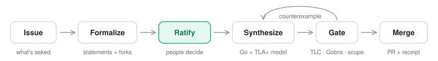
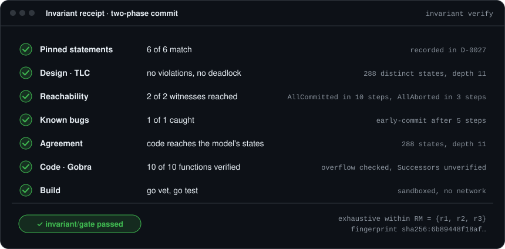

<p align="center">
  <picture>
    <source media="(prefers-color-scheme: dark)" srcset="docs/brand/logo-animated-dark.svg">
    
  </picture>
</p>

<p align="center">
  <strong>A code factory that doesn't guess.</strong><br>
  You ratify what must be true. Invariant proves every pull request against it before merging.<br>
  <a href="https://invariant.puglisij.com/"><strong>See the live dashboard →</strong></a>
</p>

<p align="center">
  
  
  
  
  
</p>

<br>

AI coding agents don't ask clarifying questions. They pick an interpretation and ship it with total confidence. Formal verification alone doesn't fix that. A proof only shows the code matches the property someone wrote down, and if the agent wrote that property, the proof just certifies the agent's guess.

Invariant splits the work where it belongs:

| People decide | Invariant proves |
| :-- | :-- |
| What must always be true: invariants, safety properties, and the bounds they're checked at | That the code satisfies them, using a model checker for the design and a verifier for the code |
| Every fork the factory can't resolve on its own | Only what it was asked to prove. Ratified statements are pinned, and the factory can't edit them |

<p align="center"><a href="#try-it"><strong>Try it</strong></a> in a minute · <a href="#use-it-on-your-repository"><strong>Use it on your repository</strong></a></p>

## How it works

<picture>
  <source media="(prefers-color-scheme: dark)" srcset="docs/assets/how-it-works-dark.svg">
  
</picture>

1. **Formalize.** Invariant drafts the properties an issue implies. Writing a formal spec forces every ambiguity into the open. You can't model a buffer, for example, without deciding what happens when it's full.
2. **Ask.** When Invariant hits a fork it can't resolve, it posts the question back on the issue as a decision request. It doesn't pick an answer for you.
3. **Ratify.** A person approves each statement. The approval is recorded along with where the statement came from, and the statement is pinned by hash.
4. **Synthesize.** Invariant writes the implementation, in Go, TypeScript or Python, and the TLA+ model. It keeps repairing them against counterexamples until the gate passes.
5. **Gate and merge.** CI re-runs every check on the committed artifacts. The pull request merges only if every check passes.

What an issue builds or changes is a **project**: one component, such as a rate limiter, with its ratified statements, its TLA+ model and its code, in a directory with an `.invariant/` folder. The gate checks each project on its own and writes a receipt for each.

## Watch it take an issue

<p align="center">
  
</p>

This is the factory's first real issue, as it happened on GitHub. [#1](https://github.com/gitdek/invariant/issues/1) asked for a bounded buffer for log shipping and left two decisions open: what happens when the buffer is full, and what happens when a send fails. Invariant didn't choose. It asked, drafted 13 statements with @gitdek's answers, and had TLC check them against a draft model before anyone was asked to ratify them. After @gitdek ratified, it wrote the code, proved it with Gobra, and opened [#2](https://github.com/gitdek/invariant/pull/2). It merged #2 itself once CI's gate passed on that exact commit.

People steer the factory with comments on the issue, and only people with write access are heard:

| On the issue | What happens |
| :-- | :-- |
| `/invariant solve`, or the `invariant` label | The factory takes the issue |
| `/invariant choose F1 A` | Decides a question the factory asked |
| `/invariant revise` | The factory drafts again, reading the comments |
| `/invariant ratify <hash>` | Ratifies exactly the proposal with that hash, and the factory carries it out |
| The `invariant:go`, `invariant:typescript` or `invariant:python` label | The factory writes the code in that language. Without one, the repository's default applies: Go here |
| A `Project: <dir>` line in the issue | Changes that existing project. The factory proposes a diff of its statements, and calls out anything removed or loosened |
| An `Agent: codex` or `Agent: claude-code` line in the issue | Picks the coding agent that drafts the issue and builds it, as the line reads when the issue is drafted. A new project's manifest records it, so the project's later issues get it unless they pick another. Without either, the factory's own agent, `-agent`, does. The factory runs Claude Code and Codex, and answers an issue that picks an agent it can't run, or Codex where it isn't set up, instead of drafting it |
| `Code: <path>` lines in the issue | Checks existing TypeScript code as it is, without changing a line. The factory writes only the model and a driver that runs the real code |
| A `Kind: plumbing` line in the issue | For a change that isn't a state machine. The factory proposes a plan covering the whole issue: what changes, the files it may touch, and acceptance tests. If the work cannot fit one reviewable pull request, it proposes a plan of at most 10 issues covering all the work instead. A writer ratifies either plan by its hash. Each build must pass its acceptance tests unchanged, and a person merges anything in the trusted base. On this repository only, for now |
| `/invariant retry` | After a failure that left a pull request open, watches it again, and builds nothing: once CI's gate passes on its current head, the factory marks a draft ready and merges it without another review, and a person merges a change to the trusted base. After a build that stopped before it made a pull request, builds the ratified proposal again |
| `/invariant plan` | On an issue that holds or links a PRD, the factory proposes a plan of at most 10 issues in place of statements. Once a writer ratifies it, the factory opens the plan's issues one at a time, each once the one before has merged, and takes each on that writer's authority |
| `/invariant stop` | On a ratified plan's issue, the factory opens no more of the plan's issues. One already open goes on as it is |

For plumbing, the factory runs formatting, vet, the tests of every touched package and the pinned acceptance tests, then has a second agent review the whole candidate against the original checkout. When review asks for changes, the same builder receives the findings in its existing workspace under the unchanged ratified plan. It gets at most two repair attempts, each followed by fresh factory checks and, only if those pass, a fresh read-only review. Only final passing checks and approval produce a ready pull request, apart from a writer's retry of a draft, below. Unresolved findings leave a draft for a person, even when a repair fails tests or runs out of time; the failure post keeps both the findings and the check failures ([#281's ratified plan](.invariant/plans/issue-281.json), [D-0105](decisions/D-0105-factory-takes-every-change.md), [D-0108](decisions/journal/D-0108.jsonl)).

A retry watches a pull request that's open, and builds again only when there's none ([D-0047](decisions/journal/D-0047.jsonl), [D-0064](decisions/journal/D-0064.jsonl)). After a build left a draft, because its agent stopped, its tests failed or its review asked for changes, or after CI's gate failed on a pull request, `/invariant retry` has the factory watch that pull request again. Once CI's gate passes on its current head, and it's still in scope with its ratified lock, the factory marks a draft ready and merges it. It never runs the review again, so a draft whose review asked for changes merges as it is unless someone pushes those changes first ([#145](https://github.com/gitdek/invariant/issues/145)). A change to the trusted base waits for a person to merge it instead, and the factory doesn't mark its draft ready ([D-0109](decisions/journal/D-0109.jsonl)). To build a plan again instead, close its pull request, say "draft the same plan again", comment `/invariant revise`, and ratify the new draft. After a build that stopped before it made a pull request, a retry builds the ratified proposal again. The factory's posts say which happens, and so does the dashboard: a card's retry button says what it does, such as "Merge #N once CI passes", `/act` asks first in the same words and says what follows once it's posted, and the comment it posts is `/invariant retry` either way ([D-0156](decisions/journal/D-0156.jsonl)). A failed draft's post lists the plan's files in the trusted base in its body, which a post too long for GitHub clips, and keeps its commands and what they do whole ([D-0167](decisions/journal/D-0167.jsonl)).

The builder may write the plan's named files and add new regular Go `*_test.go` regression files in packages the plan touches, including the nearest Go package owning a planned embedded asset and new packages the plan names. Staging, formatting, package tests, final copying and CI scope all honor that allowance. Existing unnamed tests, the ratified acceptance tests and plan, other production files and unrelated packages remain protected, and linked files are refused. The original checkout stays the baseline across every repair, so tests the builder adds can later be corrected or removed ([D-0107](decisions/journal/D-0107.jsonl), [D-0110](decisions/journal/D-0110.jsonl), [D-0133](decisions/journal/D-0133.jsonl)). CI's scope check judges a test new against the merge base a pull request's changes come from, so a branch that changes an existing test main has since deleted doesn't count as adding one. Formatting checks only the regression tests the build added, beside the named Go files and acceptance tests, so an existing test the builder may not edit never blocks a build. Package tests count only directories that still hold Go files, so a package the plan deletes isn't tested (#298, [D-0190](decisions/journal/D-0190.jsonl)).

The initial build, fallback, repairs and all reviews contribute their turns, cost, token fields and tool calls to the same build's totals, with every transcript and test log retained. They and the factory checks share one execution time allowance; another round or fallback never renews it. Waiting for an agent account's turn remains excluded ([D-0125](decisions/journal/D-0125.jsonl), [D-0154](decisions/journal/D-0154.jsonl)).

Reviewers put decision recording and checks that require unavailable Docker or network access under **Merger work**, and approve when those are all that remains. The merger completes those duties before moving on, since a plumbing build cannot write `decisions/` ([D-0122](decisions/journal/D-0122.jsonl)). #281's repair, regression-test and merger-work policy is recorded as [D-0173](decisions/journal/D-0173.jsonl). CI still runs the whole suite, and a person still merges changes to the trusted base ([D-0109](decisions/journal/D-0109.jsonl)).

Plans of issues can nest. A planned issue may itself become a ratified plan of issues, with no build or pull request of its own. Its parent waits until the factory records that child's whole plan as complete under its ratified hash; an unfinished or stopped child plan holds its parent. Completion carries upward through nested plans on later polls, opening each step and recording each plan's completion once, including after a watcher restarts.

Anyone can open an issue, but the factory takes one only when a writer labels it, or says `/invariant solve` or `/invariant plan`. That hands the issue's text to a coding agent, so read someone else's issue before you do. The agent that drafts statements has no network and no GitHub access, and nothing it drafts is built until a person ratifies it.

## Watch it catch a bug

<p align="center">
  
</p>

Passing TLC only means something if the invariants could have failed. So the gate plants known bugs in the model and requires TLC to catch each one. This is the real counterexample for the two-phase commit example's planted bug: a coordinator that commits after hearing from one resource manager instead of all three. TLC finds the shortest path to an inconsistent commit. In five steps, r2 aborts on its own, the coordinator commits anyway on r1's vote alone, and r1 commits.

## One action, one contract

<p align="center">
  
</p>

The factory owns both the model and the code, and each Go method's contract restates exactly one TLA+ action. The code refuses a step the model can't take, by itself, so its contract says both outcomes. `ok` holds exactly when the action's enabling condition held. A step it takes has the action's effect, a refusal changes nothing, and nothing else ever changes. Sending the action's message is the caller's job, since messages belong to the environment. TLC checks the model, Gobra proves the code at every size, and the gate explores the code to confirm that both reach the same 288 states.

## The gate

| Check | Tool | Fails when |
| :-- | :-- | :-- |
| Pins | Invariant | A ratified statement's text, or anything it depends on, has changed |
| Design | TLA+ · TLC | An invariant is violated, or the system can deadlock, within the ratified bounds |
| Reachability | TLA+ · TLC | A ratified witness can't be reached, so the invariants might hold only because nothing happens |
| Known bugs | TLA+ · TLC | A ratified bug, added to the model as an extra action, slips past the invariants |
| Agreement | Invariant | Go: the code, explored from its initial state, doesn't reach exactly the states TLC found in the model |
| Conformance | Invariant · TLC | TypeScript and Python: the real code, driven through its operations, takes a step the model doesn't allow |
| Code | Gobra · Nagini | A function doesn't verify against its contract, or an index or integer operation could fail |
| Build | vet · tests | Anything is red. Runs in a sandbox with no network and no secrets. |
| Scope | Invariant | A factory pull request changes anything outside its one project, adds a dependency, uses cgo, or edits CI config or a ratified lock |
| Ratification | Invariant · GitHub | A factory project's lock isn't exactly the proposal a person with write access ratified on its issue |

Every pull request carries a receipt that CI generates from tool output. It lists the states explored and the bounds they cover, the functions verified, the statement hashes, and the tool versions. The factory never writes its own receipt.

For projects without explicit components, code assurance comes from successful results: **proved** requires a successful proof naming at least one function; otherwise successful agreement or conformance establishes **tested against the model**; otherwise the code is **unchecked**. The gate records that assurance in JSON. Discovering source functions or passing a build establishes neither proof nor model testing. These claims are separate from the gate's pass or fail result: a failed check still fails the gate, while an unrelated failure does not erase successful evidence.

Markdown receipts and the dashboard derive these claims from evidence even when an older JSON report contains a stale assurance label. **Proved at every size** additionally requires a successful check one size larger. The dashboard says **tested in every state** only for successful exhaustive conformance with positive, matching visited and model state counts and no failed attempt check. A failed attempt check still leaves evidence for the transitions that conformance successfully checked. This correction builds on the tool-output receipts in [D-0013](decisions/D-0013-slice-plan.md), the proof and conformance paths in [D-0024](decisions/D-0024-checking-typescript-and-python.md) and [D-0031](decisions/journal/D-0031.jsonl), and the larger check in [D-0070](decisions/journal/D-0070.jsonl).

### Manually adopting an existing Python application

`invariant verify` checks an existing Python application against its model with sampled, authenticated read-back. It uses one staged copy and one dependency image for the whole run. Explicit components get independent evidence; omitting them keeps a legacy receipt with no invented inventory. No Nagini annotation is required, and a `# +nagini` marker does not enable proof on this path. Factory drafting and synthesis for this mode, exhaustive exploration and attempted-step checks are outside #327.

Here is a complete small application layout. Paths in `existing` and `components` are relative to `app`; model, code and conformance paths are relative to `verification/lifecycle`.

```text
app/
  requirements.txt
  deps/application.txt
  deps/constraints.txt
  tasks/__init__.py
  tasks/lifecycle.py
  tasks/application.py
  tasks/next.txt
  tests/__init__.py
  tests/test_tasks.py
  verification/lifecycle/
    driver.py
    .invariant/invariant.json
    .invariant/ratified.lock
    .invariant/specs/Lifecycle.tla
```

The two `__init__.py` files are empty. `requirements.txt` contains `-r deps/application.txt`. `deps/application.txt` contains these two lines:

```text
packaging>=24,<25
-c constraints.txt
```

`deps/constraints.txt` contains `packaging==24.2`, and `tasks/next.txt` contains `running` followed by a newline. Only application-root requirements select the environment; a verification-local requirements file cannot replace them. Installation admits public PyPI wheels, with original inputs, canonical requirements and actual wheel hashes recorded. Installation may need network; execution is offline. Omitting requirements uses the pinned standard-library image.

`tasks/lifecycle.py`:

```python
from pathlib import Path
from packaging.version import Version

def advance(state):
    assert Version('1.9') < Version('1.10')
    if state == 'pending':
        return Path(__file__).with_name('next.txt').read_text().strip()
    return 'done'
```

`tasks/application.py`:

```python
from .lifecycle import advance

def start():
    return 'pending'

def tick(state):
    return advance(state)
```

`tests/test_tasks.py`:

```python
import unittest
from tasks.application import tick

class TaskTests(unittest.TestCase):
    def test_step(self):
        self.assertEqual(tick('pending'), 'running')
```

`verification/lifecycle/driver.py` reads actual calls through the gate's stateless lifecycle handle:

```python
from invariant_observe import functional
from tasks.lifecycle import advance
from tasks import application

def drive():
    with functional(advance, application.start,
                    argument='state', field='task') as life:
        life.step(application.tick)
        life.step(application.tick)
        life.step(application.tick)

if __name__ == '__main__':
    drive()
```

The complete `.invariant/specs/Lifecycle.tla` is:

```tla
---- MODULE Lifecycle ----
EXTENDS Naturals
CONSTANT Limit
VARIABLE task
vars == <<task>>
Init == task = "pending"
Next == \/ /\ task = "pending" /\ task' = "running"
        \/ /\ task = "running" /\ task' = "done"
        \/ /\ task = "done" /\ UNCHANGED task
Spec == Init /\ [][Next]_vars
Safe == task \in {"pending", "running", "done"} /\ Limit >= 1
Seen == task = "done"
Bad == task' = "broken"
Fair == WF_vars(Next)
Eventually == <> (task = "done")
====
```

`.invariant/invariant.json`:

```json
{
  "name": "Task lifecycle",
  "language": "python",
  "code": ".",
  "module": ".invariant/specs/Lifecycle.tla",
  "conformance": "driver.py",
  "existing": ["tasks/lifecycle.py"],
  "components": {
    "scope": ["tasks"],
    "checks": [{
      "target": {"source": "tasks/lifecycle.py", "symbol": "advance"},
      "tests": [{"source": "tests/test_tasks.py", "symbol": "TaskTests.test_step"}],
      "conformance": [{"source": "verification/lifecycle/driver.py", "symbol": "drive"}],
      "invocations": [
        {"id": "unit", "kind": "test", "check": {"source": "tests/test_tasks.py", "symbol": "TaskTests.test_step"}, "command": "python", "args": ["-m", "unittest", "tests.test_tasks.TaskTests.test_step"], "working_dir": ".", "inputs": ["tasks/next.txt"]},
        {"id": "sample", "kind": "conformance", "check": {"source": "verification/lifecycle/driver.py", "symbol": "drive"}, "command": "python", "args": ["driver.py"], "working_dir": "verification/lifecycle", "sampling": {"runs": "2", "steps": "4", "seed": "1"}, "inputs": ["verification/lifecycle/.invariant/specs/Lifecycle.tla", "verification/lifecycle/.invariant/ratified.lock"]}
      ]
    }]
  }
}
```

For the omitted-components variant, remove the entire `components` member and its preceding comma. Keep `existing`, which may also select directories containing Python sources. The gate discovers lexical bindings for execution, runs normal `unittest` discovery from the application root and executes the manifest driver with default maximum budgets 1000 runs / 40 steps / seed 1. It creates no component inventory or coverage for neighbors. Explicit configurations require an executable invocation for every selected test/driver; they never fall back to discovery.

Start a **new, unratified** `.invariant/ratified.lock` with the following proposal. This example supplies no decision, ratifier or pinned hashes:

```json
{
  "bounds": {"Limit": "2"},
  "statements": [
    {"name": "Spec", "kind": "spec", "says": "Runs start pending and follow the lifecycle."},
    {"name": "Safe", "kind": "invariant", "says": "Task state is pending, running or done."},
    {"name": "Seen", "kind": "witness", "says": "Completion is reachable."},
    {"name": "Bad", "kind": "bug", "expect": "Safe", "says": "The invariant catches a broken task state."},
    {"name": "Fair", "kind": "fairness", "says": "Continuously enabled lifecycle progress eventually occurs."},
    {"name": "Eventually", "kind": "property", "says": "Every fair run eventually completes."}
  ]
}
```

A human reviews the model, bounds, statements, selected code and driver before ratifying. In the adopting repository, record a proposed decision with `invariant decisions decide -door two-way -status proposed "Adopt the lifecycle model and bounds after human review."`; use the actual returned decision ID as the new lock's `decision`. After review, the human runs `invariant pin app/verification/lifecycle` to pin the reviewed statements and `invariant decisions ratify -by @YOUR_LOGIN D-NNNN`, substituting their own login and the real decision ID. An agent may record that ratification only when that person explicitly asks. Do not copy a fixture identity or another project's hashes, invent a ratifier, or repin an existing ratified lock without its authorizing decision.

With host Python 3 and Docker available, run:

```sh
invariant verify -out receipt app/verification/lifecycle
```

The command writes `receipt/receipt.json` and `receipt/receipt.md`. Passing yields exit 0; a failed check yields a receipt and exit 1; unsupported preflight or setup failure yields exit 2. TLC checks Init and Next for the authenticated observations at `Limit = 2`, in batches for larger samples. The receipt shows actual executions, selected versus actual launcher settings, model/includes, dependencies, resources, observations and independent outcomes. Failed/skipped/unexecuted tests, runtime/import errors or invalid/missing observations fail, as do pin, ratification or design obligations. Successful independent evidence survives. Component rows say origin `gate` or `supplied`; public attribution always treats incoming data as supplied and cannot change the gate verdict. Neither origin is an authorization token. Proofs and unselected neighbors stay unchecked, assumptions stay assumed, and runtime tests confer no target coverage or invented assertions.

This is **sampled tested-against-the-model evidence**: exhaustive design checking does not make the implementation exhaustive, prove it, check every attempted step or cover every size. Fractions and unsupported observation values fail TLC encoding explicitly; integer values are preserved exactly. D-0183's collector trust boundary and stateless handles remain as described below.

The gate/receipt execution policy is recorded as [D-0185](decisions/journal/D-0185.jsonl), and this real suite passed on #328's final head:

```sh
INVARIANT_PYTHON_APPLICATION_GATE_REAL=1 go test ./internal/verify ./internal/conformance ./cmd/invariant -run '^TestPythonApplicationGate' -count=1 -timeout 45m
```

Default acceptance checks execute actual local Python with Docker transport and TLC doubles; they do not skip or claim real Docker/TLC validation. The opt-in command requires real Docker, TLC and wheel installation and fails if prerequisites are absent.

### Existing Python application foundation

[#310's ratified plan](.invariant/plans/issue-310.json) admits Python `existing` manifests with a conformance driver. `project.ResolvePythonApplication` returns an absolute `Root` and slash-separated `ProjectPath`: exactly one strict ancestor of the verification directory must contain every named regular `.py` source or directory containing Python sources. Requirements and Python markers are optional and never select among ambiguous roots. Missing selections, ambiguous roots, unclean paths, absolute paths, parent escapes, backslash aliases, selection `.` and symlinks fail, including links from root to the verification directory.

Only this new mode uses application-relative component scopes, references, assumption sources, invocation working directories and inputs. Manifest model, conformance and code paths stay contained and verification-project-relative. Python lexical identities and exact contract bytes are unchanged, with IDs based on application-relative sources. Scope remains nonrecursive and associated tests and drivers remain input provenance. Legacy Python and TypeScript retain their discovery, staging and identity rules.

`verify.StagePythonApplication` requires a missing or empty destination disjoint from the application, with no symlink path components. It copies the full application layout and original bytes, including verification files, tests, sibling code and resources, excluding only `.git`, `.venv` and `__pycache__` directories. Explicit selections and inputs in exclusions fail; symlinks and nonregular entries in the copied tree fail. Errors return no workspace; callers own and remove the destination, including partial copies. The workspace exposes `Root`, the reloaded staged `Project`, an `Inventory` resolved from staged bytes and sorted `Files` hashing every copied file. Each file also belongs to explicit inventory provenance, without adding production scope. Fingerprints cover unselected siblings, resources, tests and drivers, contain no host paths and remain stable across relocation; later original edits cannot alter the copy or snapshot.

`PythonApplicationWorkspace.SelectImage(ctx)` uses `toolchain.PythonDepsImage` on the staged application root and its recursive requirements inputs. Verification-local requirements and later original edits cannot replace them. Without root requirements it returns `toolchain.PythonImage`, nil dependencies and no Docker call. Otherwise it returns the immutable dependency image and existing original/canonical input and artifact evidence, preserving validation, isolation and cache reuse. Errors yield no image and never fall back; no new installer or application command runs.

An application that runs as `uv run serve.py` declares its dependencies in the script, in a [PEP 723](https://peps.python.org/pep-0723/) `# /// script` block, and uv ignores any `requirements.txt` beside it, which may belong to the application's tools. For such an application, the manifest names the script as `environment`, relative to the application root, and `SelectImage` builds the environment from the block instead, through the same preflight, pinned pip parser, canonical form, installer and wheel evidence ([#320](https://github.com/gitdek/invariant/issues/320)). The block must be the script's only `script` block and declare at least one dependency. Its `requires-python` must admit the pinned Python, and `[tool.uv]` settings, which can change resolution, are refused rather than ignored. The receipt names the script and its block's digest. The image's identity follows the block, so editing the rest of the script reuses it. The application's files never change.

`verify.PreparePythonApplicationSession(ctx, p, dst, PythonApplicationSessionOptions{})` prepares a directly callable test and sampled-observation adapter under [#313's ratified child plan](https://github.com/gitdek/invariant/issues/313#issuecomment-6536681769) (`sha256:0380e0c90425c12cb24fed241112820b07758fecb6d812130b71424a857d2366`) and [#315's implementation plan](.invariant/plans/issue-315.json). It validates every invocation before image selection, stages the complete application, selects one immutable dependency image (or acquires the pinned standard-library base), and reuses it for every `session.Run(ctx, key)`. `Invocations()` and `Provenance()` return detached views; keys include target, check, kind and ID. The destination follows `StagePythonApplication`'s ownership rules. `Close()` releases private runtime/output resources, is idempotent and prevents further runs; callers still remove the destination, including partial copies after preparation failure.

Explicit tests require literal command `python` and ordered arguments `-m unittest` followed by explicit dotted selections, with no discovery, options or implicit suite. Safe environment values are preserved exactly; interpreter, import, loader, proxy and adapter controls are reserved. Tests have effective `runs=1` and no declared sampling. Under [#318's ratified plan](.invariant/plans/issue-318.json), conformance executes the configured script as `__main__` from its declared working directory, with literal ordered argv. Its path must resolve to both the manifest driver and the selected conformance source. The selected driver declaration must actually execute; the adapter never implicitly calls `drive()`. Decimal `runs`/`steps` in 1–2147483647 are maximum lifecycle/step budgets, and `seed` in 0–2147483647 seeds Python's random generator (defaults 1000/40/1). Exceeding a budget fails. Declared controls and effective settings remain separate. Proof invocations are rejected.

The staged runtime supplies `invariant_observe`. A functional lifecycle calls a staged application initializer, owns its scalar return as current state, passes it as the first argument to the surrounding application entry, and reads the selected target's actual argument and return:

```python
from invariant_observe import functional
from tasks.lifecycle import advance
from tasks import application

def drive():
    with functional(advance, application.start, argument="state", field="task",
                    expected_initial={"task": "pending"}) as life:
        life.step(application.tick, expected_before={"task": "pending"},
                  expected_after={"task": "running"})

if __name__ == "__main__":
    drive()
```

Here `application.start()` returns `"pending"`, and `application.tick(state)` returns `advance(state)`. These are unchanged application functions outside the driver. The entry must be distinct from the selected target and execute exactly one selected call; its returned state must equal that call's result. Functional state is value-semantic: strings, booleans, finite numbers or `None`, with no mutable-object identity claim.

For ordinary instances, declare state-key-to-attribute readers instead. For example, `Task.advance` updates `self.state`, and `Application.tick` calls that method on its task:

```python
from invariant_observe import instance
from tasks.application import Task, Application

def drive():
    task = Task()
    with instance(task.advance, fields={"task": "state"},
                  expected_initial={"task": "pending"}) as life:
        life.step(Application(task).tick, expected_before={"task": "pending"},
                  expected_after={"task": "running"})

if __name__ == "__main__":
    drive()
```

The gate reads scalar attributes directly from that receiver's own `__dict__` initially and at call entry/return, and checks the final entry state. The observed receiver must be the exact bound instance. The collector retains the original receiver independently of the lifecycle handle; replacing its target or receiver fails even if the replacement has the same state. Contexts may coexist and interleave; each gets an ordered run number and an execution-local instance number, with initial sequence 0 and steps 1 onward. Each context must close after at least one step. Initial/pre/post expected dictionaries are optional comparisons, never evidence or state overrides. State must continue from the preceding post-state, including when expectations are omitted.

The `functional` and `instance` forms support only ordinary undecorated synchronous module functions and instance methods with staged lexical code and intact module/class bindings. An explicitly selected instance wrapper outside the `existing` files must directly import a selected source and call its intact staged module function inside every observed target step; an import alone earns no evidence. This preserves existing instance sessions without admitting unrelated targets. These forms refuse async/generators, decorators, concurrency and mutable state, and require literal-scalar defaults on targets and entries. All forms refuse closures, wrappers, substituted code or bindings, unbound/static/class methods, custom metaclasses or attribute access, slots, property/descriptor readers, callback readers and non-JSON evidence. Reentrant/nested selected calls, missing or multiple selected calls, cross-instance substitution, empty/unclosed/reused contexts, import/runtime failures and caught observation errors cannot produce accepted evidence. Application source is never rewritten.

[#321's ratified plan](.invariant/plans/issue-321.json) adds `module(target, *, fields, expected_initial=None, timeout=5.0)`. It reads copied JSON state from the selected staged module function's own globals. Targets and distinct staged module entries outside the driver can be synchronous or async. Registration decorators are accepted only when the live binding remains the lexical function itself; the collector never unwraps. `life.step(entry, *args, expected_before=None, expected_after=None, **kwargs)` forwards arguments solely as inputs. Module entries may also have arbitrary object defaults, including framework declarations such as `Form('')`: the original positional default tuple, keyword default mapping and each keyword default value must remain unreplaced, including before the first step and between steps. These objects supply no evidence. Targets still require literal-scalar defaults.

For a complete standard-library web-shaped example, the unchanged application `tasks/lifecycle.py` can register an async submission handler and start a worker:

```python
import asyncio
import threading
import uuid

tasks = {}
routes = {}

def register(fn):
    routes[fn.__name__] = fn
    return fn

@register
def advance(key):
    tasks[key]["status"] = "done"

@register
async def submit(upload, *, content_type="application/octet-stream"):
    assert upload is not None and content_type
    await asyncio.sleep(0)
    key = uuid.uuid4().hex
    tasks[key] = {"status": "reserved"}
    threading.Thread(target=advance, args=(key,)).start()
    return {"task": key}
```

Select `advance` as the target and use this conformance driver:

```python
from invariant_observe import module
from tasks import lifecycle as app

def drive():
    with module(app.advance, fields={"status": "tasks[*].status"},
                expected_initial={"status": []}, timeout=5.0) as life:
        life.step(app.submit, object(), content_type="image/png",
                  expected_before={"status": []},
                  expected_after={"status": ["done"]})

if __name__ == "__main__":
    drive()
```

Paths start with an ASCII identifier (`[A-Za-z_][A-Za-z0-9_]*`) naming a module global, followed by any number of `.identifier` dictionary keys, `[nonnegative decimal index]` list indices or `[*]` projections. For example, `tasks[*].status`, `rows[0].value` and `meta` are valid. Projections traverse exact dictionary values in insertion order or exact list elements and return a list of the remaining suffix, including `[]` for no elements. Leaves are deeply copied exact dictionaries with string keys, lists and finite JSON scalars. Missing keys/indices, wrong container types, subclasses, cycles, malformed paths, attributes, coercions, evaluation and callbacks fail. Expectations compare the entire copied state with type-sensitive equality; they never supply state.

A module step reads before the entry, checks continuity, then reads after the entry and all threads it started (including descendants) have finished. Reservations and worker mutations belong to that step; intermediate target-entry/return state need not match. Exactly one completed, nonrecursive selected call must occur beneath the entry, its returned awaitable or an owned thread. Coroutine resumptions count as one call. Awaitables run in a fresh event loop that closes afterward; unfinished coroutines (including manually suspended or retained unstarted coroutines), failed auxiliary tasks and cancellations fail. Ownership follows thread objects and start events, never reusable IDs or timing alone. Preexisting, unrelated and driver-started threads fail, even if they never call the target. One total deadline covers the entry, awaitable and draining every owned thread: `timeout` must be a positive finite number, defaults to 5 seconds and cannot exceed 60. A separate watchdog process terminates the disposable runner with a diagnostic and no accepted observations on timeout, even while application code holds the interpreter's GIL, for non-daemon workers or for code catching cancellation. Module contexts may interleave, using module identity for instance numbering and the same continuity rules as other forms.

Module rows add `form: "module"` and retain exact paths in `readback`; initial entry is the target. Receipts retain raw JSON lists and dictionaries. Only at the sampled TLC boundary are lists recursively translated to ordered sequences and dictionaries to ordinary records. Application keys never act as `$seq`, `$set`, `$fn` or `$mv` tags: keys that cannot encode as TLA+ record identifiers fail explicitly, as do `None`, fractions and other unrepresentable values. Exact integers survive. Authentication, freshness, poisoning, sampling budgets, stateless handles and the assurance limits below apply to all three forms. This extends [D-0183](decisions/journal/D-0183.jsonl) through the existing [D-0185](decisions/journal/D-0185.jsonl) sampled gate, for both explicit and omitted components.

The module observation policy is recorded as [D-0186](decisions/journal/D-0186.jsonl), refining D-0183, and both opt-in suites passed on #331's final head:

```sh
INVARIANT_PYTHON_APPLICATION_EXECUTION_REAL=1 go test ./internal/verify -run '^TestPythonApplicationExecutionModule' -count=1 -timeout 30m
INVARIANT_PYTHON_APPLICATION_GATE_REAL=1 go test ./internal/verify -run '^TestPythonApplicationGateModuleObservations$' -count=1 -timeout 30m
```

Successful driver results have `observation_mode: "sampled"` and ordered `observations`, with an empty `tests` array. Each raw record includes `kind`, `run`, `instance`, `sequence`, the full invocation `key`, lexical `target`, `driver`, `symbol` and `entry`, their source hashes, and `readback` (`{"task":"$return"}` or `{"task":"state"}`). Initial records carry `state`; transitions carry actual `before` and `after`, for example `{"task":"pending"}` and `{"task":"running"}`. No assertions or test outcomes are invented. This remains sampled even if a driver imports a legacy exploration harness: The public gate now checks these observations with TLC and attributes actual results under #327. Proof, exhaustive-state and attempted-step coverage remain outside this path.

Go independently requires complete, nonempty, correctly bound output and exit 0. Invalid driver execution returns `Success=false`, diagnostics and no accepted observations. A fresh execution identity prevents replay even for the same session/key. The runner also authenticates the exact ordered collector stream with a per-execution HMAC key, consumed and removed before application imports and kept out of the application-readable request. Copying request bindings into fabricated output cannot earn success. Lifecycle handles hold no state, so a driver can't substitute evidence through them: every binding, read-back and continuity check uses the collector's own records, and touching any handle attribute besides `step()` and the `with` protocol poisons the execution, even if the driver catches the error. The trust boundary is the gate's own code. Python in the same process can always reach the collector's module, objects, frames and closures, so no in-process collector can rule out a driver that tampers with them. That driver's bytes are bound to every observation it makes, and authentication defends against output written or replayed outside the collector, not against such tampering. The authentication footer and execution identity never enter portable JSON or fingerprints. Provenance binds both runner and collector assets, the full staged tree and dependency evidence. Changes before, during or between executions invalidate observations without another image selection. Repeated and relocated identical runs have identical portable results. Successful drivers cannot alter, promote or replace independently observed runtime-test outcomes.

The adapter uses absolute Python with site/user-site and implicit paths disabled, effective hash seed 0, trusted imports before application root and driver directory before dependency libraries, including namespace packages. The default executor uses offline linux/amd64 Docker, `--pull=never`, memory/process limits, read-only inputs/runtime and separate writable output, with cancellation cleanup. `SelectImage` and `Execute` options replace those operations for orchestration or recording; `RunPythonApplicationCommand` exposes the same default executor. No image fallback, dependency installation or Nagini execution occurs on Run.

Structured observations record actual unittest IDs separately from configured lexical checks, using the executed method's staged source and lexical location. Passed, failed, error, skipped, expected failure, unexpected success and not-run outcomes remain distinct; skipped cases retain their reason and are never exercised or passed. Missing, substituted, malformed, incomplete or unsuccessful execution cannot earn success, and valid preceding observations survive later failure. Provenance hashes every staged file and the runner and retains original/canonical dependency input hashes and actual wheel evidence. Result fingerprints bind declared and actual settings and ordered observations, excluding host paths, local image IDs and operational diagnostics. Snapshot content, membership, symlinks and replacements are checked around preparation and every execution. Original bytes stay unchanged; runtime-test records infer no assertions, target coverage, proof, conformance or project assurance.

Shared preflight, `verify.Run`, `Python.Check` and prepared sessions admit sampled existing Python applications, with or without components. Unsupported proof selections, exhaustive or attempted modes, missing selected invocations and mismatched drivers fail before verification tools or dependency installation; malformed explicit configurations never fall back to legacy execution. Model-only checking, supplied attribution, legacy Python/marked files and TypeScript retain their behavior. [D-0181](decisions/journal/D-0181.jsonl) records the preceding session/runtime-test policy. The observation/execution policy, with its trust boundary, is recorded as [D-0183](decisions/journal/D-0183.jsonl), and `INVARIANT_PYTHON_APPLICATION_EXECUTION_REAL=1 go test ./internal/verify -run '^TestPythonApplicationExecution' -count=1 -timeout 30m` passed on #323's final head. The suite runs meaningful actual-Python checks without Docker and enables real Docker only explicitly, failing on missing prerequisites.

The direct adapter also builds on [D-0013](decisions/journal/D-0013.jsonl), [D-0029](decisions/journal/D-0029.jsonl), [D-0047](decisions/journal/D-0047.jsonl), [D-0170](decisions/journal/D-0170.jsonl), [D-0171](decisions/journal/D-0171.jsonl) and [D-0180](decisions/journal/D-0180.jsonl). This foundation builds on [D-0054](decisions/journal/D-0054.jsonl), [D-0158](decisions/journal/D-0158.jsonl), [D-0168](decisions/journal/D-0168.jsonl), [D-0177](decisions/journal/D-0177.jsonl), [D-0178](decisions/journal/D-0178.jsonl), [D-0122](decisions/journal/D-0122.jsonl).

### Component configuration and evidence in ordinary Go and Python

The first slice of [#212](https://github.com/gitdek/invariant/issues/212) adds optional `components` metadata to `.invariant/invariant.json`. It inventories Go source and resolves intended checks. [#304's ratified plan](.invariant/plans/issue-304.json) extends discovery to explicit Python scopes. [#234](https://github.com/gitdek/invariant/issues/234) adds an API to attribute supplied proof results to those components and render their evidence. [#257](https://github.com/gitdek/invariant/issues/257) retains target assumptions, inert invocation declarations and exact input provenance in that inventory. [#274's ratified plan](.invariant/plans/issue-274.json) adds independent supplied assumption records and optional actual proof provenance. [#279's ratified plan](.invariant/plans/issue-279.json) adds independent supplied conformance results, with separate qualifications for checked transitions, exhaustive states and tried steps. **Sampled existing Python applications support explicit component verification.** Other explicit code configurations return `verify.ErrComponents` before verification tools. Python syntax discovery may run its isolated parser. Model-only checking through `verify.RunModel` remains available. Omitting `components` preserves legacy verification and infers no component inventory. Python manifests with nonempty `existing` support discovery and staging, plus directly callable test and sampled driver sessions with explicit components under #315 and #318. The public sampled gate supports these manifests with or without components; omitted components create no inventory.

For example, a Go manifest can include:

```json
{
  "components": {
    "scope": ["core"],
    "checks": [
      {
        "target": {"source": "core/ops.go", "symbol": "(*Counter).Step"},
        "proof": {
          "contracts": [{"source": "core/ops.go", "symbol": "(*Counter).Step"}]
        },
        "tests": [{"source": "core/ops_test.go", "symbol": "TestStep"}],
        "conformance": [{"source": "drivers/explore.go", "symbol": "Drive"}],
        "assumptions": [
          {
            "id": "serialized",
            "statement": "Calls to Step are serialized.",
            "reason": "The caller holds the counter lock.",
            "source": "notes/caller-contract.md"
          }
        ],
        "invocations": [
          {
            "id": "seeded",
            "kind": "conformance",
            "check": {"source": "drivers/explore.go", "symbol": "Drive"},
            "command": "go",
            "args": ["run", "./drivers", "--seed", "7"],
            "working_dir": ".",
            "env": {"MODE": "test"},
            "sampling": {"seed": "7", "runs": "3"},
            "inputs": ["data/fixture.json", ".invariant/specs/Counter.tla", ".invariant/ratified.lock"]
          }
        ]
      }
    ]
  }
}
```

The component path base is the application root for Python manifests with nonempty `existing`, and the verification project otherwise. In the following rules, project-relative component paths use that base. `scope` names a nonempty list of package directories relative to that base (`.` names its root), each read without descending into subdirectories. The inventory includes every non-test source file for the manifest's language and every named function and method declared there, including unselected neighbors and files with no functions. Go discovery is independent of build tags. Python discovery includes synchronous, asynchronous, decorated and nested declarations, including declarations inside control-flow suites. Strings, comments, lambdas, aliases and classes themselves add no function components. `checks` may be empty. Each target and its selected contracts must be in scope; test and conformance references may name files elsewhere inside the project. Tests must refer to declarations in `_test.go` for Go, or `test_*.py` or `*_test.py` for Python; those files are excluded from production discovery. A `proof` requires at least one contract. Loading validates every reference, requires selected contracts to have attached Gobra annotations for Go or supported inline Nagini calls for Python, and rejects duplicate scopes, targets or associations, missing or ambiguous declarations, malformed source and paths that escape the project. Paths must be clean, relative and use `/` separators; all source and scope paths reject symbolic links, including links inside the project.

Each check may also declare `assumptions` and `invocations`; existing manifests need neither. An assumption requires nonblank `id`, `statement` and `reason`, plus a `source` naming a regular file inside the project. Its ID is unique within the target and remains stable when its text or source bytes change. An assumption alone is enough to configure a target, but grants no proof or other evidence. A target with no proof, tests, conformance or assumptions is invalid.

An invocation requires `id`, `kind`, `check`, `command` and `working_dir`. IDs and commands must be nonblank. Its `kind` is `proof`, `test` or `conformance`; `check` uses the source-and-symbol reference shown above. A proof invocation must name its own target with configured proof; a test or conformance invocation must name a selection of that kind for its target. Invocation IDs are unique within `(target, kind, check)`, so one selected check can have several invocations. Optional `args` is an ordered string list; `env` and `sampling` are maps of explicit string values with nonblank keys. The command and all values remain literal: no command runs, no shell expands them, and no environment is inferred.

`working_dir` must name an existing project-relative directory, with `.` allowed. Optional `inputs` explicitly lists regular files; duplicates within an invocation are errors. Assumption sources, inputs and working directories reject path aliases, escapes and symlinks, including symlinks that point inside the project. Inputs may include fixtures, configuration, dependency manifests and lockfiles, TLA+ models and includes, and `ratified.lock`. Their exact bytes, including ratified bounds, are hashed without interpreting them or requiring new model inputs in old manifests. These declarations do not attest that an invocation ran or that all its execution inputs were declared; later adapters can compare caller-supplied execution snapshots with the declarations ([D-0168](decisions/journal/D-0168.jsonl)).

Each Go component has an ID such as `go:example.com/app/core#(*Counter).Step@core/ops.go`: language, the import path from the nearest enclosing `go.mod` within the project, the symbol and its project-relative source path. Functions use `Func`; methods use `Type.Method` or `(*Type).Method`. Every initializer uses `init[1]`, `init[2]`, and so on. Blank-named declarations use `_[1]`, `Type._[1]` or `(*Type)._[1]`. Ordinals start at 1 for each receiver-qualified symbol in each file, in declaration order, even for a single declaration, and selections use those numbered symbols too. IDs survive checkout relocation and body or line-number edits; reordering declarations with the same ordinal base can change which declaration an ordinal selects.

Python IDs are `python:<module>#<symbol>@<source>`, for example `python:core.ops#Counter.step@core/ops.py`. The module is the source path relative to the component path base without `.py`, with `/` replaced by `.`, retaining `__init__`: `core.py` and `core/__init__.py` remain distinct. Class nesting adds a dot, and function nesting adds `.<locals>.`, as in `outer.<locals>.Local.method`. Repeated declaration names in each lexical namespace, including containing classes, receive `[1]`, `[2]`, and so on in source order; unique names have no ordinal. Descendants inherit their parents' ordinals. Selections use the complete lexical symbol, including ordinals; bare ambiguous names fail. Relocation, host import paths, configuration ordering, decorators and ordinary body or line edits leave IDs unchanged. Reordering repeated declarations can change which declaration an ordinal selects.

Python contract hashes concatenate the exact original expression bytes of direct standalone, unqualified `Requires`, `Ensures`, `Exsures` and `Decreases` calls in the owning function's immediate suite, in source order without separators. Multiline calls and one-line suites are supported. Each span covers the call expression through its closing parenthesis, retaining internal comments, indentation, original encoding and CRLF bytes. Surrounding comments, indentation and newlines, bodies, the `# +nagini` marker, decorators, strings, nested suites and nested declarations do not contribute. Qualified calls, aliases and calls used inside assignments or other expressions are unsupported contracts. No supported call means an empty contract hash. This is syntax discovery, with no name resolution or assurance claim; the marker still belongs to the separate legacy Nagini proof path.

Python discovery requires `python3` (Python 3.8 or newer) on the host, with syntax support determined by that runtime. The plumbing sandbox is built from the pinned Python image, so its `python3` is the one the collector runs under in production, recorded beside the image's digest as `toolchain.PythonVersion`. CI runs the Python tests under the runner's default `python3` in `invariant/verify`, and again under that minor version in `invariant/python`, which `invariant/gate` requires. Where `INVARIANT_PYTHON_PINNED` is set, as there and in the sandbox, a test fails if `python3` isn't the image's minor version ([D-0189](decisions/journal/D-0189.jsonl)). The embedded parser runs with `-I -S`, uses only the standard library and receives source bytes on stdin: it ignores `PYTHONPATH`, excludes project imports and site startup hooks, and never imports or executes inspected code, decorators, defaults or annotations. It installs no dependencies and invokes no project commands. These discovery rules build on [D-0023](decisions/D-0023-more-languages.md), [D-0024](decisions/D-0024-checking-typescript-and-python.md), [D-0031](decisions/journal/D-0031.jsonl), [D-0152](decisions/journal/D-0152.jsonl) and [D-0158](decisions/journal/D-0158.jsonl), and #304's Python identity and contract-hashing rules are recorded as [D-0177](decisions/journal/D-0177.jsonl).

`project.ResolveComponents` returns a canonical inventory: sorted scope, files, component IDs, checks and association IDs. Assumptions sort by ID, invocations by `(kind, check, id)`, and each invocation's inputs by path; argument order is preserved. Resolved invocation checks use canonical component IDs, and assumption sources and invocation inputs become `{path, sha256}` snapshots. Every nested slice and map belongs to the snapshot, so later configuration or file edits cannot change it. Each file and component carries the SHA-256 of its complete source file; a Go component separately hashes the exact attached doc-comment block, including its final newline, when it contains Gobra annotations. A component without a supported contract has an empty contract hash. Hashes use `sha256:<lowercase hex>`. The inventory and selections carry no assurance or verification evidence.

The inventory's `files` and `components` still describe scoped production only. Its separate `provenance` contains `declarations`, the unique selected test and conformance component snapshots sorted by ID; `files`, the whole selected source files, assumption sources and invocation inputs sorted and deduplicated by path; and `modules`, every nearest `go.mod` used to resolve production or selected identities, also sorted and deduplicated. Python derives module identities solely from paths and has no `provenance.modules`. A `go.mod` named in `inputs` also appears in `provenance.files`. Selecting a test or driver outside scope does not inventory unrelated files or add production coverage. A driver independently included in production scope stays unchecked without its own qualifying proof.

`(*verify.Report).AttributeComponentProofs(*project.ComponentInventory, []verify.ComponentProofResult) error` accepts an explicit inventory on a report that is not model-only. Each result keeps its existing `Target`, `Verifier`, `Passed`, `Inputs`, `Verified`, `Contracts` and `Errors` fields and JSON names. Targets must be distinct configured production proof targets; all declaration references use canonical IDs and matching source and contract snapshots. Extra known references, including selected test and driver declarations in provenance, remain valid without transferring proof. The API runs no tools. Future execution adapters must establish these supplied facts from actual runs; configuration and legacy function names cannot supply them.

Proof results may also supply `Invocation *project.ResolvedComponentInvocation`, `FileInputs []project.ComponentFile` and `Tool *verify.ComponentProofTool`, omitted from JSON when absent under `invocation`, `file_inputs` and `tool`. An actual invocation must match a selected `(kind=proof, check=target, id)`, command, ordered arguments, working directory, environment, sampling and input snapshot set. Actual file snapshots are separate from declaration `Inputs`: a nonempty set must include the target source, and every file must match the production, provenance or module snapshots. Known extra files beyond the invocation's declared inputs are allowed. Invocation and file provenance can be supplied independently. Tool `Name`, `Version` and optional `Pins map[string]string` use JSON `name`, `version` and `pins`; they are opaque supplied data. Existing proof-only callers need none of these fields or a new provenance object, and attribution synthesizes none of them.

`(*verify.Report).AttributeComponentAssumptions(*project.ComponentInventory, []verify.ComponentAssumptionRecord) error` accepts supplied records on the same terms. Each record has `Target string`, `Input project.Component` and `Assumption project.ResolvedComponentAssumption` (`target`, `input`, `assumption` in JSON). The production target snapshot and selected assumption must match exactly, including its ID, statement, reason and source snapshot. Records are unique by `(target, assumption.id)` and remain explicitly **assumed** and **unverified**. A declaration without a supplied record creates no assumption evidence; neither a record nor a declaration proves its target or neighbors.

A target is **proved** only when its result passed, names a verifier, has no errors, includes that exact target among the verified IDs, covers every selected contract, and supplies matching snapshots for every verified or checked-contract ID. Missing, failed or incomplete results leave it **unchecked**. A proof never transfers to a neighbor or to a declaration used as a contract, even when the same run names it as verified; each needs its own qualifying target result. Unknown or duplicate references, unselected targets and stale snapshots are rejected without changing the report.

`(*verify.Report).AttributeComponentConformance(*project.ComponentInventory, []verify.ComponentConformanceResult) error` accepts independently supplied conformance results on the same terms. Each result names an exact production `Target`, selected canonical conformance `Check` and required `Invocation`; `(target, check, invocation.id)` must be unique. Different checks and repeated invocations remain separate records. The invocation must match its declaration, including kind, check, ID, command, ordered arguments, working directory, environment, sampling and input snapshots. Bare names, unknown or unselected references, duplicates and stale supplied snapshots are errors. Missing facts can leave a result unchecked, but a missing invocation is an error.

`ComponentConformanceResult` retains JSON `target`, `check`, `invocation`, `runner`, `inputs`, `file_inputs`, `model`, `bounds`, `mode`, `outcome`, `checked`, `runs`, `steps`, `states`, `transitions`, `model_states`, `observations`, `attempts` and `diagnostics`. `Runner *ComponentProofTool` identifies the supplied runner by name, version and optional pins. `ComponentConformanceModel` holds `module` (the project-relative model source path) and `inputs` (source and explicitly supplied include snapshots). `ComponentConformanceBounds` holds `values` and `sources`. A `ComponentConformanceObservation` records `run`, `step`, `action`, ordered `args`, and `from` and `to` state maps. Optional `ComponentAttemptResult` separately retains `outcome`, `attempts`, `states`, ordered `observations` and `diagnostics`. Modes are `sampled` or `bounded-exhaustive`; conformance and attempt outcomes are `passed`, `failed`, `timed_out`, `skipped`, `empty` or absent. Counts must be nonnegative. Qualification preserves all supplied modes, outcomes and nested values; diagnostics do not override an outcome.

Successful conformance needs matching actual declaration snapshots for the target, every selected proof contract and the driver, plus actual file snapshots for their sources and every invocation, model and bounds input. Model and bounds source snapshots must match declared invocation inputs; `model.module` must identify a snapshot in `model.inputs`, and `bounds.values` must equal the report's ratified bounds. `Design.Spec` names a behavior, not the model source. Attribution compares supplied snapshots without reading files, parsing models or locks, or finding omitted includes or dependencies. Outside-scope drivers add provenance only; conformance grants no proof to a target, contract, driver or neighbor.

A conformance row is **tested** only when its actual outcome is `passed`, its mode is present, runs, steps and states are positive, its runner has a name and version, `checked` includes its selected check, and provenance is complete. Otherwise it is **unchecked**. Declarations, positive counts, package success and legacy conformance alone establish no component evidence. The following qualifications all require that tested result:

| JSON qualification | Additional requirement |
| :-- | :-- |
| `transitions_checked` | Positive `transitions`. |
| `exhaustive_states` | `bounded-exhaustive` mode, positive equal `states` and `model_states`, and either absent attempts or successful nonempty attempts. Sampled runs never qualify. |
| `every_step` | Attempts with outcome `passed` and positive `attempts` and `states`. This describes tried steps in observed states, not proof or exhaustive state coverage. |

Absent attempts grant no `every_step` claim, but alone do not block exhaustive states. Present failed, timed-out, skipped, empty or missing-outcome attempts block exhaustive states while preserving successful checked transitions. A run with only checked refusals can qualify for exhaustive states without a positive transition count.

`(*verify.Report).AttributeComponentRuntime(*project.ComponentInventory, []verify.ComponentRuntimeResult) error` accepts independently supplied runtime records on an explicit report that is not model-only. Each result names a production `Target`, selected canonical test `Check` and required selected `Invocation` of kind `test`, unique by `(target, check, invocation.id)`. The invocation must match its declaration's check, ID, literal command, ordered arguments, working directory, environment, sampling and input snapshot set. Different checks and repeated invocations stay distinct. Missing invocations, bare names, unknown, duplicate, unselected or stale references reject the whole batch.

`ComponentRuntimeResult` retains JSON `target`, `check`, `invocation`, `runner`, `inputs`, `file_inputs`, optional `model` and `bounds`, `outcome`, `tests` and `diagnostics`. Runner identity and pins reuse `ComponentProofTool`; optional context reuses `ComponentConformanceModel` and `ComponentConformanceBounds`. Every supplied declaration and file snapshot is retained, including known extra inputs beyond the invocation's declaration. Each `ComponentRuntimeTestResult` has a selected canonical `check`, `exercised`, `outcome`, optional `assertions` and `diagnostics`; checks are unique within a result. Each `ComponentRuntimeAssertionResult` has a nonblank `id`, optional `source` snapshot, `exercised`, `outcome` and optional `diagnostics`. Assertion IDs are opaque and unique within their test and invocation, rather than component identities. A supplied source must match a known input file. At every level, outcomes are `passed`, `failed`, `timed_out`, `skipped`, `empty` or absent; diagnostics remain ordered data and cannot replace outcomes. Unreported tests and assertions remain absent, even when selected or when a process or legacy check passed.

Runtime qualification requires a runner name and version, matching actual target and selected-contract declarations and source files, and all invocation input snapshots. Each actual test also needs its own matching declaration and source. Ordinary runtime tests need no model or bounds context; when supplied, model and bounds sources must match declared invocation inputs, `model.module` must identify a supplied model snapshot, and bounds values must match the report's ratified bounds. Missing required actual snapshots or incomplete supplied context leave evidence **unchecked**; mismatches reject it.

| Runtime evidence | Qualification with the required provenance |
| :-- | :-- |
| Test **tested** | The actual test has `exercised:true` and outcome `passed`, independently of process success. No assertion records are required. |
| Assertion **passed** | Its parent test and the assertion were actually exercised, its own outcome is `passed`, and its matching source snapshot is present in actual `file_inputs`, including extra supplied files. It can pass even when its test or process failed. |
| Runtime row **tested** | The process outcome is `passed` and an actual qualifying test names the row's selected `check`. |

Other qualifications remain **unchecked**, preserving unsuccessful, missing-outcome and unexercised records. A passing test or process cannot make a failed or unexercised assertion pass. Runtime evidence establishes no target code coverage, proof, exhaustive conformance, every-step coverage or validated assumption.

All four attribution operations replace only their own evidence kind; an empty slice clears only that kind. Each validates a detached inventory, incoming records and every retained kind, including on clears, before committing once. Duplicate scopes, declarations, files, selections and local identities, unknown references and inconsistent snapshots are rejected; matching overlaps between production, provenance and module collections are valid. Retained proof, conformance and runtime attempts must still match their original selections, targets, contracts, tests, drivers, invocations and supplied inputs, even when incomplete; omitted actual snapshots do not remove the original inventory's anchors. Changes to outside-scope drivers, test sources, assertion sources, non-Go inputs, dependencies, model sources or includes, bounds sources, report bounds or invocation metadata invalidate retained evidence that depends on them. Changed selections cannot promote or demote retained proof coverage. Retained assumptions must still match their target and selected declaration, including its content and source. Any error leaves report JSON bytes and stored and recomputed fingerprints unchanged. Success deep-copies all nested slices and maps, including retained evidence, preserves legacy checks, ratified data and gate pass or fail, and finalizes the fingerprint. Old proof callers remain valid without execution metadata, including extra known verified declarations, checked contracts and matching snapshots.

JSON adds `components`, containing the complete `inventory`, `proofs` and optional `assumptions`, `conformance` and `runtime`. Proof rows remain `{target, status, result?}`, one per production component sorted by ID, unchecked without their own qualifying proof. Assumption rows are `ComponentAssumptionEvidence` with `{target, status:"assumed", verified:false, record}`, sorted by target and assumption ID; `verified` is present even though false. Conformance rows are `ComponentConformanceEvidence` with `{target, check, status, transitions_checked, exhaustive_states, every_step, result}`, sorted by `(target, check, result.invocation.id)`; all three booleans remain present when false. Runtime rows are `ComponentRuntimeEvidence` with `{target, check, status, tests?, result}`, sorted by the same tuple. Their `ComponentRuntimeTestEvidence` rows have `{check, status, assertions?}`, sorted by check, and `ComponentRuntimeAssertionEvidence` rows have `{id, status}`, sorted by ID. Empty assumptions, conformance and runtime may be omitted; declarations never synthesize missing records. Markdown keeps every production component's independent proof row and adds separate conformance, runtime, assumption and input-provenance views. Configuration-only selections and declared assumptions are visible separately from supplied records; missing results create no evidence rows. Each supplied kind shows exact target and check identities, source and contract hashes, actual invocation metadata, ordered arguments, environment and sampling, tool identity and pins, declaration and file inputs, model and bounds, observations, outcomes and diagnostics. Input-only tests and drivers remain provenance, never extra production coverage. Reports say **component evidence**, with no overall assurance score, project-wide proof or every-size claim, including after JSON decoding with a stale assurance label. The explicit prose and footer acknowledge supplied results and declared assumptions, always assumed / unverified, and explain that the component API runs no tools; legacy footers still say "tool output only".

Markdown qualifies conformance from supplied outcomes and provenance, even after decoding JSON with stale status flags: sampled observations never establish exhaustive states; positive matching bounded-exhaustive states may establish every state with absent attempts, but never every step. Present failed, timed-out, skipped, empty or missing-outcome attempts block exhaustive-state and every-step claims without erasing successful observations. Every-step coverage requires successful nonempty attempts and states. Runtime preserves independently qualifying tests and assertions when enclosing outcomes fail, while process success invents no exercise, assertions or target code coverage. Unknown mode, outcome or status strings remain inert text and cannot establish success. Missing optional metadata renders without inventing evidence; assumptions remain assumed / unverified even with stale decoded labels.

Throughout explicit component receipts, literals use escaped `<code>` elements: fingerprints, statement names and pins, bounds, toolchain versions, images and recipes, and names, actions, paths, hashes and states in evidence rows and failure descriptions. Each original value is escaped once before assembling prose and markup, so underscores, ampersands, backticks, literal entity strings and line endings retain their characters without double escaping. Untrusted text cannot create HTML, links, table cells or rows, or forge component associations or statuses; this includes assumption text and origins, invocation metadata, observations, outcomes and diagnostics. Hash and image digest shortening is unchanged. Rendering preserves the report and original JSON values, fingerprints, gate outcomes, component proof coverage and all legacy Markdown.

The fingerprint binds the complete scope and files, including unchecked neighbors and files without functions, component and contract identities, selected checks, proof snapshots, outcomes and verifier pins. It also binds selected test and driver snapshots, declared and supplied assumption identities, targets, snapshots, labels, statements, reasons and source bytes, declared and actual invocation identities and check associations, commands, ordered arguments, working directories, explicit environment and sampling maps, each invocation's input references and exact bytes, actual file inputs, tool identity and pins, and the nearest module files. Every conformance and attempt field is bound: identities, qualifications, runner pins, modes, outcomes, checked references, counts, declaration and file snapshots, model identity and includes, bounds values and sources, observations and diagnostics. Every runtime field is bound too, including each test and assertion's identity, qualification, exercise flag, outcome, source and diagnostics, plus runner pins, invocations, every supplied input and optional model and bounds context. Optional evidence presence is bound. Attribution owns every nested value. Canonicalization applies after attribution and JSON decoding without mutating the report: reordering reference sets, runtime tests and assertions or record completion order, or relocating the checkout, does not change the fingerprint; arguments, observations and diagnostics remain meaningful ordered sequences. Existing volatile metadata stays excluded, including timestamps, build output, the Go toolchain's patch version, trace output paths and the coding agent, as required by [D-0135](decisions/journal/D-0135.jsonl).

The first slice of [#229](https://github.com/gitdek/invariant/issues/229) corrects legacy assurance claims as described above. Successful legacy Go, Python and TypeScript receipts retain their Markdown, fingerprints and unverified-function lists. No component scope is inferred: a successful legacy proof still lists the functions outside its proof, and its project-wide label does not establish proof of those neighbors. The legacy assurance policy is [D-0161](decisions/journal/D-0161.jsonl); component direction and inventory are [D-0152](decisions/journal/D-0152.jsonl) and [D-0158](decisions/journal/D-0158.jsonl).

These four APIs attribute supplied proof, assumption, conformance and runtime records only: no execution, discovery, instrumentation, execution protocol, adapter or gate connection is added, and no filesystem lookup is performed during attribution ([D-0169](decisions/journal/D-0169.jsonl), [D-0170](decisions/journal/D-0170.jsonl)). [#244](https://github.com/gitdek/invariant/issues/244)'s evidence foundation for the narrowed step 1 of [#210](https://github.com/gitdek/invariant/issues/210) now includes completed Markdown and JSON receipts through [#296](https://github.com/gitdek/invariant/issues/296), with component dashboard views still later work: bounded or sampled conformance, runtime checks and trusted assumptions as separate evidence kinds alongside proof. #210's plan is narrowed to the path ask3d needs: #294 then checks unchanged Python against a model, backs trusted dependency contracts with tests and proves selected Python functions in place, each connecting the gate for its path. Its Go steps, the checks on callers against proved contracts and the CI check on evidence regressions wait until ask3d shows they're needed ([D-0172](decisions/journal/D-0172.jsonl)). TypeScript discovery is outside this ordinary Go and Python scope. Explicit code verification outside sampled existing Python still returns `verify.ErrComponents` before verification tools run. Explicit Python configurations support discovery and direct application test and sampled driver sessions; explicit TypeScript discovery remains rejected; model-only checking remains available and its reports reject all four attribution APIs, including clears. Existing proof policy is [D-0163](decisions/journal/D-0163.jsonl), declaration provenance is [D-0168](decisions/journal/D-0168.jsonl), independent proof and assumption attribution is [D-0169](decisions/journal/D-0169.jsonl), conformance attribution is [D-0170](decisions/journal/D-0170.jsonl), and runtime attribution is [D-0171](decisions/journal/D-0171.jsonl). The merger of [#296](https://github.com/gitdek/invariant/issues/296) records the remaining receipt-policy roll-up refining D-0169 before moving on: this plumbing build cannot write `decisions/`. Keeping this description current is required by [D-0122](decisions/journal/D-0122.jsonl).

## One model, three languages

Python projects can declare application dependencies in a project-root `requirements.txt`. The gate follows local `-r`/`--requirement` and `-c`/`--constraint` inputs recursively, including shared files in both roles. Supported files are UTF-8, optionally with a leading BOM, with LF or CRLF, comments, single trailing backslash continuations, named PyPI requirements with extras, version specifiers, unevaluated markers and SHA-256 hashes. Only ASCII spaces separate hash options. Includes must stay inside the project at every traversed directory, without symlinks or cycles. URLs, paths, archives, editables, environment interpolation and other pip options are refused, as are invalid encoding, bare CR, encoding declarations in comments, other line separators, unsupported backslashes and ambiguous marker literals containing `#` or option tokens.

Strict preflight runs before Docker. On a fresh daemon, both dependency APIs acquire the existing digest-pinned Python base for `linux/amd64` only when it is missing or unavailable for that platform. Acquisition failure stops the operation with Docker's diagnostic. That base's own pip then parses the original files offline, with `--pull=never`, absolute Python in isolated mode (`-I`), a clean working directory and a read-only project mount. Every report and row field must be present and non-null before policy checks; explicit empty values remain valid. Missing specifiers or markers cannot silently remove a pin or condition. Pip refusals and incomplete or failed reports stop selection and execution, even with a cached dependency image.

Pip's report produces `canonical/requirements.txt` and `canonical/constraints.txt`, one requirement and its hashes per line. Installation reads only those literal-directory copies, without changing the application. The image build uses isolated Python from a clean directory and installs only public-PyPI wheels with `pip --target` into a separate library directory. Only installation has network access; source builds and private indexes are unsupported. Docker-client proxy defaults, including credentials and both cases of proxy variables, are suppressed for gate containers and image builds without changing the user's configuration or daemon selection.

Checks run the base's absolute interpreter with site startup, user sites and implicit source paths disabled, and hash seed 0 effective for compilation, tests, ordinary conformance and larger-bound runs, including projects without requirements. After startup, trusted standard-library and gate paths precede the application root and driver directory, which precede installed libraries. Import resolution also protects application namespace packages from dependency regular packages, including nested namespaces. Installed scripts stay off PATH; `.pth`, `sitecustomize` and `usercustomize` do not run on startup. Imported dependencies execute as part of the application under test and receive no separate proof claim.

One immutable image ID supplies installation evidence and ordinary and larger-bound checks. Receipts and fingerprints record the base, platform, complete recipe identity, original and canonical input hashes, and resolved wheel names, versions, filenames and SHA-256 hashes, also through component attribution. Cached images retain their actual resolution; a fresh build of unpinned requirements may resolve differently. Nagini keeps its separate pinned dependencies. Projects without `requirements.txt` keep the standard-library path. Python existing-code discovery and staging are available through the foundation APIs below; the direct session/test adapter is available under #315, with sampled driver read-back under #318; #327 connects sampled TLC checking, report attribution and the public gate. Contract checks, proof, exhaustive and attempted-step checks remain later work.

This implements [#227's ratified plan](.invariant/plans/issue-227.json), on the existing toolchain, conformance and isolation foundations ([D-0013](decisions/journal/D-0013.jsonl), [D-0029](decisions/journal/D-0029.jsonl), [D-0030](decisions/journal/D-0030.jsonl), [D-0031](decisions/journal/D-0031.jsonl), [D-0032](decisions/journal/D-0032.jsonl), [D-0047](decisions/journal/D-0047.jsonl), [D-0054](decisions/journal/D-0054.jsonl), [D-0122](decisions/journal/D-0122.jsonl)). The merger must record the new dependency-policy decision and add its citation to the affected SPEC bullets; this plumbing build cannot write `decisions/`. Before merging, the merger must run the real Docker/PyPI suite on the final pull request head and post its passing output:

```sh
INVARIANT_PYTHON_DEPS_REAL=1 go test ./internal/verify -run '^TestPythonDependenc' -count=1 -timeout 30m
```

The same ratified two-phase commit, pinned by the same hashes, checked in each of the languages Invariant targets:

| Implementation | How the code is checked | Evidence |
| :-- | :-- | :-- |
| [Go](examples/02-twophase-commit) | **Proved at every size.** Gobra verifies every function against a contract that restates a TLA+ action. | The code reaches exactly the model's 288 states, and its 1,568 one size larger |
| [Go, written by the factory](examples/02-twophase-commit-synthesized) | **Proved at every size**, in the same way | Written from the ratified statements alone. It passed on its first gate run |
| [TypeScript](examples/02-twophase-commit-ts) | **Tested against the model** in every state it can reach. Its driver tries every step in every state, and TLC checks each one. | All 288 of the model's states, 4,896 steps tried, refusals included, and none outside the model |
| [Python](examples/02-twophase-commit-py) | **Proved at every size.** The factory rebuilt it on [#51](https://github.com/gitdek/invariant/issues/51) around a core Nagini verifies, 8 of 8 functions | All 288 of the model's states, no step outside it |
| [Python, proved](examples/02-twophase-commit-py-proved) | **Proved.** Nagini verifies every step function against a contract that restates a TLA+ action. | Explored completely: all 288 of the model's states, no step outside it |

The receipt always says which kind of evidence it is. Plant the early-commit bug in the TypeScript or the Python and the gate rejects it at the exact step: the coordinator commits after a single vote.

A proof goes further than any run. Plant a `tm_commit` in the proved Python that goes wrong only if the coordinator had already aborted. No run can reach that state, so the tests and conformance pass. The contract doesn't rule it out, so Nagini rejects it.

The factory writes all three languages itself. The log buffer @gitdek ratified on [#1](https://github.com/gitdek/invariant/issues/1) was rebuilt from the statements alone, in each language, and every version passed on its first gate run:

| The factory's log buffer | How the code is checked | Evidence |
| :-- | :-- | :-- |
| [Go](examples/03-log-buffer), merged in [#2](https://github.com/gitdek/invariant/pull/2) | **Proved.** Gobra verifies 5 of 5 functions | The code reaches exactly the model's 87 states |
| [TypeScript](examples/03-log-buffer-ts) | **Tested against the model** in every state it can reach. The driver explores the state machine completely | All 87 of the model's states, no step outside it |
| [Python](examples/03-log-buffer-py) | **Proved.** Nagini verifies 5 of 5 functions | All 87 of the model's states, no step outside it |

Then the factory took its next issue as its own bot, `invariant-code-factory[bot]`. [#3](https://github.com/gitdek/invariant/issues/3) asked for a token-bucket rate limiter in TypeScript. The bot asked two questions, drafted 12 statements with the answers, committed the ratification, wrote [the code](examples/04-api-rate-limiter), opened [#4](https://github.com/gitdek/invariant/pull/4), and merged it once CI's gate passed: 26 minutes from issue to merge. The code is tested against the model in all 6,375 of its states. @gitdek made the two decisions and ratified; the bot did everything else.

## Watch it catch a real bug

Then Invariant went to work on code nobody wrote for it. copythis-ad is a Next.js app whose video-analysis workers claim jobs under leases, renew them, and complete their attempts. Leases can run out, stalled jobs get retried, and people cancel. An issue asked the factory to check that protocol as it is, without changing a line: `Code: src/lib`.

- **It asked instead of guessing.** A lease can run out before the recovery sweep records it, and the code, its comments and its tests didn't agree on what a person's retry should do in that window. @gitdek chose: a cancel wins, but a retry must never erase the record that the attempt may have been charged.
- **It proposed 19 statements**, checked by TLC in 1,682 states before anyone ratified them. Six were known bugs the rules must catch.
- **Its driver ran the real store,** in memory and on its own clock, in a sandbox built from the app's own lockfile, and TLC checked every step against the model. At first the driver skipped the one step the new rule was about. A review caught that before merge, and D-0059 now forbids it. Once the skip was gone, the gate caught the real code taking that step: a stalled retry canceled a possibly charged attempt and requeued the job, so nobody would ever review it.
- **The fix was one guard, in an ordinary pull request,** and then the bot merged the check. From then until copythis-ad started over, in October 2026, every pull request to it ran the real lease code against the rules @gitdek ratified.

## Watch it build itself

Then Invariant turned on itself. The rules that decide what the factory does on an issue are what make it trustworthy. They cover who can direct it, what it may ratify, and when it may merge. Until slice 7, they were ordinary Go, checked only by tests.

- **It formalized its own rules.** [#9](https://github.com/gitdek/invariant/issues/9) described the factory's issue protocol in plain language, written from the watcher's code. The factory drafted a TLA+ model of one issue, checked in 8,334 states, with five known bugs the rules must catch. One of them is a merge of a commit that's no longer the pull request's head. The statements were ratified on the issue.
- **It proved them.** The factory wrote [`factory/protocol`](factory/protocol) in Go, Gobra proved every step against its contract, and the bot merged [#11](https://github.com/gitdek/invariant/pull/11) once CI proved it again.
- **The proof caught its own author.** Wiring the watcher to the proved core, [#12](https://github.com/gitdek/invariant/pull/12), means the watcher takes a step only if the model has it. Its own tests then showed three steps it had always taken that the ratified rules didn't have: a build that stops before it opens a pull request, a build that fails its own gate, and a pull request that passes CI but can't merge.
- **It changed its rules through itself.** [#13](https://github.com/gitdek/invariant/issues/13) asked the factory to add those steps. It asked two questions, including what a writer can do after a build stops, and @gitdek answered them. Then it proposed the amendment, checked by TLC in 24,762 states. @gitdek ratified it from the dashboard's new `/act` page, the first ratification made there. The factory changed its own proved core, and CI proved it again before the bot merged [#15](https://github.com/gitdek/invariant/pull/15).

## Stop it anywhere

<p align="center">
  
</p>

The watcher takes each step as a few effects on GitHub, and it can stop between any two: a crash, a restart, a laptop going to sleep. Two watchers can also run on one repository at once.

- **It modeled its own recovery.** [#23](https://github.com/gitdek/invariant/issues/23) asked the factory to prove that every effect happens exactly once, whatever stops it, and that every command is still answered. It drafted 23 statements, among them two "eventually" properties under ratified fairness, which the gate now checks.
- **It proved the core.** The factory wrote [`factory/recovery`](factory/recovery), Gobra proved it at every size, and the bot merged [#25](https://github.com/gitdek/invariant/pull/25). It took 31 minutes and $1.74 of agent spend.
- **The watcher runs on it.** It records each agent run and merge where every watcher can see them, and one watcher at a time holds a lease in a Git ref. It takes every effect only as the proved core allows ([#24](https://github.com/gitdek/invariant/pull/24), [#26](https://github.com/gitdek/invariant/pull/26)).

The test above stops the watcher before each of its effects and starts a fresh one. Every time, the issue still merges with every effect done once.

## Try it

With Go 1.27.1 or later and Docker installed, run:

```bash
git clone https://github.com/gitdek/invariant && cd invariant
go run ./cmd/invariant verify examples/02-twophase-commit
```

The first run pulls about 440 MB of pinned images, and Docker must run linux/amd64 images, as Rosetta does on Apple Silicon. It prints a receipt. This is the real one for the [two-phase commit example](examples/02-twophase-commit):

<p align="center">
  
</p>

<details>
<summary>The receipt as text</summary>

| Check | Result | Evidence |
| :-- | :-- | :-- |
| Pinned statements | ✅ 6 of 6 match | ratified by @gitdek on [#65](https://github.com/gitdek/invariant/issues/65#issuecomment-5875563672), amending D-0027 |
| Design · TLC | ✅ no violations, no deadlock | 288 distinct states (1,146 generated), depth 11 |
| Reachability | ✅ 2 of 2 witnesses reached | `AllCommitted` in 10 steps, `AllAborted` in 3 steps |
| Known bugs | ✅ 1 of 1 caught | early-commit: `TCConsistent` violated after 5 steps |
| Agreement | ✅ code reaches the model's states | 288 states, depth 11 |
| One size larger | ✅ code reaches the model's states | 1,568 states, depth 14, within `RM = {r1, r2, r3, r4}` |
| Code · Gobra | ✅ proved: 10 of 10 functions verified | 10 with contracts, overflow checked, not verified: Init, load, store, mv, Try, Abstract |
| Code · conformance | ✅ tested against the model: every reachable state, no step outside it | 4,896 steps recorded, 288 of 288 model states visited |
| Every step tried | ✅ in every state reached, but where only the environment's bounds rule a step out | 4,896 attempts in 288 states, refusals included |
| Build | ✅ go vet, go test | sandboxed, no network |

Checked within `RM = {r1, r2, r3}`, and again one size larger, within `RM = {r1, r2, r3, r4}`. Within each, TLC's search is exhaustive. Gobra proves the code against its contracts at every size, and the design's rules are claimed only within the sizes checked.

</details>

## Use it on your repository

The factory runs on your machine. It polls GitHub through `gh`, runs its agents with your own headless coding agent, on your account, and merges only what your CI's gate passes. You need:

- **Go 1.27.1 or later, and Docker** that can run linux/amd64 images, as for [Try it](#try-it).
- **`gh`,** logged in as someone with write access to the repository.
- **A headless coding agent,** logged in: Codex, which the factory runs by default, on `gpt-6-astra` at its highest reasoning. Claude Code runs only where you turn it on.

1. **Build the CLI from a clean checkout,** so it knows which commit of Invariant it is. `go install` doesn't work yet, because the module has `replace` directives. Any directory on your `PATH` will do:

   ```bash
   git clone https://github.com/gitdek/invariant && cd invariant && go build -o ~/.local/bin/invariant ./cmd/invariant
   ```

2. **Add the gate to your repository,** and commit it yourself, since the factory can't change CI. The workflow builds Invariant at your CLI's commit and runs the gate on every pull request:

   ```bash
   cd path/to/your-repo && invariant init -repo OWNER/NAME
   git add .github/workflows/gate.yml && git commit -m "Add Invariant's gate" && git push
   ```

3. **Require the gate, and allow merge commits.** GitHub then refuses any merge the gate didn't pass, yours included. `app_id` 15368 is GitHub Actions, so only the workflow's own check counts. The factory merges with a merge commit:

   ```bash
   gh api -X PUT repos/OWNER/NAME/branches/main/protection --input - <<'EOF'
   {"required_status_checks":{"strict":false,"checks":[{"context":"invariant/gate","app_id":15368}]},"enforce_admins":true,"required_pull_request_reviews":{"required_approving_review_count":0},"restrictions":null}
   EOF
   gh api -X PATCH repos/OWNER/NAME -F allow_merge_commit=true
   ```

4. **Run the factory:**

   ```bash
   invariant watch -repo OWNER/NAME -projects invariant -language go
   ```

   `-projects` is the directory new projects go in. `-language` is what the factory writes when an issue doesn't pick one: `go`, `typescript` or `python`. `-agent` is the coding agent that drafts and builds an issue when neither it nor its project picks one: `codex`, the default, or `claude-code`. The watcher runs only the agents `-agents` names, `codex` alone unless you add `claude-code`, so it never starts Claude Code otherwise. Codex runs on `gpt-6-astra` at `ultra`, its highest reasoning (`-codex-model`, `-codex-effort`). The factory acts as you, through `gh`. To have it act as its own bot, [set up a GitHub App](docs/factory-app.md) and add `-app-id`. With Claude Code turned on, its runs may spend up to $3 of estimated cost drafting statements, and $5 a build, on your account (`-formalize-budget`, `-budget`). A Codex run is capped by its steps (`-codex-steps`). Before it takes an issue, the watcher checks that it can run its coding agent, and any a project's manifest names: that the agent's CLI runs and is signed in. If one can't run, it doesn't start, and says what to fix. For Codex, sign it in once to a home of its own, which its commands can't read:

   ```bash
   mkdir -p "$HOME/Library/Application Support/invariant/codex"
   CODEX_HOME="$HOME/Library/Application Support/invariant/codex" codex login
   ```

   Codex's commands then run under a permission profile of Codex's own: they see only the workspace, the system and Go's toolchain, reach no network, and can't read your home directory. The watcher checks that before it runs Codex, and runs one Codex run at a time.

5. **Open an issue** that describes a component and what must always be true of it, and label it `invariant` or comment `/invariant solve`. [#18](https://github.com/gitdek/invariant/issues/18) is a good model. The factory asks about anything it can't settle, proposes statements, and builds once a writer ratifies them.

`Kind: plumbing` issues work only on this repository for now ([#103](https://github.com/gitdek/invariant/issues/103)).

The live dashboard gives each running step its own card, with its activity, tool calls and stretches of thinking. A Codex card's thinking total sums the `usage.reasoning_output_tokens` reported by completed turns, counting each whole transcript line once. Until a turn reports that count, the card uses estimates from reasoning length, as it does for older transcripts without reasoning usage. The first reported count, including zero, replaces those estimates. The thinking statistic and total legend then show full integers without an approximation sign (`thinkingExact` in the live JSON). During later turns the total stays at the last reported sum while the card shows the current activity; refreshes and the end of the step retain that sum.

Reasoning items still appear as timed thinking stretches with their own estimated tokens, and later items don't inflate a reported total. Claude Code keeps accumulating its streamed estimates. Each card keeps its own counts, and a replaced transcript starts fresh. The public view publishes counts, times and paths inside the agent's copy only, never commands, agent words, output or reasoning text ([D-0051](decisions/journal/D-0051.jsonl), [D-0116](decisions/journal/D-0116.jsonl), [D-0136](decisions/journal/D-0136.jsonl), [D-0159](decisions/journal/D-0159.jsonl), [D-0160](decisions/journal/D-0160.jsonl)).

The watcher gives every draft or build invocation its own directory, including retries within the same second, and publishes its basename in the step's status as `run` after creating it and before starting the agent. The activity strip and banner checks read only that named run under the selected watcher and issue. A new step starts without a run; an absent run, directory or required file shows no activity or checks from an earlier run. Directory names are opaque identities, so their timestamps, sort order and modification times never select a run ([D-0166](decisions/journal/D-0166.jsonl)).

At `/act`, behind Cloudflare Access, **Show shell commands** displays each running step's shell invocations verbatim beside its activity strip, with their existing kind and start/end times. It starts off on every page load. Turning it off, losing access, ending a step or replacing its run clears the display, and a late response cannot restore it. Commands are inert text, with no tool output or reasoning, and retained only for the strip's bounded recent window. Only an authenticated `GET /act/api/live.json?commands=1` includes them, with `Cache-Control: no-store`; the default private response, public responses and agent listener never include command text. This private view follows [#236's ratified plan](.invariant/plans/issue-236.json), an exception to [D-0116](decisions/journal/D-0116.jsonl) for this page only ([D-0165](decisions/journal/D-0165.jsonl)), behind the existing [Access boundary](decisions/journal/D-0065.jsonl).

## Status

Pre-alpha. The gate works end to end in Go, TypeScript and Python. The factory turns an issue into a merged pull request, with the code written in any of the three and checked against statements a person ratified on the issue.

- [x] **Slice 1 · The gate.** TLC, Gobra, and receipts on a hand-built [two-phase commit](examples/02-twophase-commit).
- [x] **Slice 2 · Synthesis.** Headless Claude Code rebuilt the model and the code from the ratified statements and the request alone. It [passed on its first gate run](examples/02-twophase-commit-synthesized), in 12 turns and under two minutes.
- [x] **Slice 3a · TypeScript and Python conformance.** Existing code is tested against the model, and the receipt says so.
- [x] **Slice 3b · Nagini spike.** Nagini proves a [Python core](examples/02-twophase-commit-py-proved) of two-phase commit, 8 of 8 functions, and catches a bug no run can reach.
- [x] **Slice 4 · GitHub.** [Issue #1](https://github.com/gitdek/invariant/issues/1) became a decision request, then a ratification, then [pull request #2](https://github.com/gitdek/invariant/pull/2), which the factory merged itself once CI's gate passed. The result is [`examples/03-log-buffer`](examples/03-log-buffer).
- [x] **Slice 5 · TypeScript and Python.** The factory writes both from ratified statements alone. The log buffer passed the gate on its first run in [TypeScript](examples/03-log-buffer-ts), tested in all 87 states, and in [Python](examples/03-log-buffer-py), proved with Nagini. Then the factory's own bot took [#3](https://github.com/gitdek/invariant/issues/3), a TypeScript rate limiter, from issue to merge.
- [x] **Slice 6 · Changing existing projects.** Amendments work: [#5](https://github.com/gitdek/invariant/issues/5) changed the rate limiter to refuse calls once too many are waiting, and the bot merged [#6](https://github.com/gitdek/invariant/pull/6) once CI's gate passed. And the factory checks existing code in other repositories, as it is: in copythis-ad, it caught a real bug in a production lease protocol.
- [x] **Slice 7 · Invariant builds itself.** The factory formalized its own issue protocol on [#9](https://github.com/gitdek/invariant/issues/9), wrote it as [`factory/protocol`](factory/protocol), proved with Gobra, and then changed it through [#13](https://github.com/gitdek/invariant/issues/13). Since [#12](https://github.com/gitdek/invariant/pull/12), the watcher checks every step it takes against it.
- [x] **Slice 8 · Code you can ship.** The factory now writes code with no model bounds in it, and the gate proves it at every size: [#18](https://github.com/gitdek/invariant/issues/18) asked for a connection pool, and the bot merged [#20](https://github.com/gitdek/invariant/pull/20), proved by Gobra at every size and in agreement with TLC one size past the bounds. The log buffer was rebuilt the same way, and code that hardcodes a size fails the gate.
- [x] **Slice 9 · The factory survives crashes and concurrent work.** The gate checks liveness: properties such as "every command is eventually answered" hold under ratified fairness. [#23](https://github.com/gitdek/invariant/issues/23) asked the factory to model its own crash recovery, and the bot merged [#25](https://github.com/gitdek/invariant/pull/25), proved at every size, for $1.74 in 31 minutes. The watcher now holds a lease, records its runs, and takes every effect only as that core allows. Stopped before any of its effects, it finishes the issue with every effect done once. Two watchers then ran on this repository for a day. When the old lease ran out, both reached for it in the same second: GitHub took the first watcher's push and refused the second's, since the lease had already moved. The second then read the first's next 563 renewals and never acted. ([D-0069](decisions/D-0069-slice-9-plan.md))
- [x] **Slice 10 · Public.** The repository is public, and GitHub refuses any merge to `main` without a pull request and a passing gate, the owner's included. Every run from an outside contributor needs approval ([D-0075](decisions/D-0075-slice-10-plan.md)).
- [x] **Slice 11 · A driver can't skip a step.** The gate checks that the code driving a project's code through its model tried every step a person could take, in every state it reached, except where only a bound rules one out, and a second agent reviews every driver. The factory rebuilt all twelve projects here through twelve issues: six TypeScript and Python drivers on Invariant's harness ([#47](https://github.com/gitdek/invariant/issues/47) to [#52](https://github.com/gitdek/invariant/issues/52)) and six Go explorers that report every step they try ([#64](https://github.com/gitdek/invariant/issues/64) to [#69](https://github.com/gitdek/invariant/issues/69)). Every receipt shows every step tried: 3,626,031 attempts in all, refusals included, 3,020,964 of them for the factory's own protocol. Every Go project is now proved at every size. Along the way, the check caught the agent's own first driver skipping a write into a full buffer while building [#54](https://github.com/gitdek/invariant/pull/54). The review caught a driver on [#59](https://github.com/gitdek/invariant/pull/59) that kept the code's messages itself, and three problems in the driver of copythis-ad's next pull request that no check could see ([D-0082](decisions/D-0082-slice-11-plan.md)).
- [x] **Slice 12 · One decision graph for every project.** Every project's decisions move into one embedded store, SQLite used as a graph, with a journal in each repository and traversal tools agents call over MCP, so a decision can be traced to what rests on it and what implements it ([D-0096](decisions/D-0096-decision-graph.md)). This repository's decisions are in it. copythis-ad's were too, from a journal of its own ([copythis-ad#41](https://github.com/gitdek/copythis-ad/pull/41)), so a question crossed projects: what in copythis-ad rested on one of Invariant's decisions. That repository has since started over and left Invariant. `invariant decisions` records and answers, coding agents ask it over MCP, CI checks it on every change, and the dashboard draws it ([#135](https://github.com/gitdek/invariant/pull/135)). Now [#177](https://github.com/gitdek/invariant/issues/177) proves the journal in four parts, and three are in. Decision IDs are proved unique, and `decide` runs on the proof ([#192](https://github.com/gitdek/invariant/issues/192)). A decision's state is proved to be the fold of its lines, and every fold runs on the proof ([#193](https://github.com/gitdek/invariant/issues/193)). The store's journal is proved only to grow, and every write and rebuild runs on the proof ([#195](https://github.com/gitdek/invariant/issues/195)).
- [ ] **Slice 13 · The factory takes every change, and a whole PRD.** Plumbing goes through the factory too, with a plan and tests where a model doesn't fit, and a PRD becomes a plan of issues a person ratifies, which the factory works one at a time ([D-0105](decisions/D-0105-factory-takes-every-change.md)). In progress: the factory built eleven of its own plumbing changes on 2026-09-29, and since [#134](https://github.com/gitdek/invariant/pull/134) it works on three issues at once. `/invariant plan` turns a PRD into a plan of issues to ratify ([#139](https://github.com/gitdek/invariant/pull/139)), and the factory now works each plan a writer ratifies, one issue at a time ([#144](https://github.com/gitdek/invariant/pull/144), [#148](https://github.com/gitdek/invariant/issues/148)). It planned [#153](https://github.com/gitdek/invariant/issues/153), the first real PRD, then opened and built its first issue itself. The dashboard's `/act` plans too: it opens a PRD with `/invariant plan`, or plans an open issue a writer opened that the factory hasn't taken ([#201](https://github.com/gitdek/invariant/issues/201)). Paused from 2026-09-29 to 2026-10-29, while coding agents built changes by hand; it runs again since, on Codex.
- [ ] **Slice 14 · Codex on chosen projects.** A project picks its coding agent, Codex or Claude Code, and the factory runs Codex under the same rules, limits, view and records as Claude Code ([#153](https://github.com/gitdek/invariant/issues/153)). In progress: an issue picks its agent with an `Agent:` line, else its project's manifest does, that agent drafts and builds it ([#173](https://github.com/gitdek/invariant/issues/173)), and every record of its work names it ([#179](https://github.com/gitdek/invariant/issues/179)). Built by hand while the factory is paused: the factory takes back only regular files from an agent's workspace, Codex has a backend that runs it headless under a permission profile of its own, where its commands see nothing outside the workspace, the watcher checks its agents at start, the live view shows a Codex run, and Codex gets the decision graph's tools. Its first run built the two-phase commit and passed the final gate with proof ([#189](https://github.com/gitdek/invariant/pull/189)). Next: the factory's first Codex issue, once it resumes. Since 2026-10-29, Codex is the default everywhere, on `gpt-6-astra` at its highest reasoning, and Claude Code runs only where it's turned on ([#207](https://github.com/gitdek/invariant/issues/207)).
- [ ] **Slice 15 · Verification inside ordinary code.** Ordinary Go and Python stay as they are, the critical components get proved in place, and Invariant checks how the code around them uses them, one component at a time, with every receipt saying what's proved and what's only tested. In progress: [#212](https://github.com/gitdek/invariant/issues/212)'s first slice inventories Go components and validates intended checks. [#229](https://github.com/gitdek/invariant/issues/229)'s first slice derives legacy assurance from successful evidence. [#234](https://github.com/gitdek/invariant/issues/234) adds an API for attributing proof results to exact Go components and recording complete coverage in fingerprints and JSON and Markdown receipts. [#257](https://github.com/gitdek/invariant/issues/257) retains assumptions, inert invocation declarations and exact input provenance through that proof-report path. [#274](https://github.com/gitdek/invariant/issues/274) adds independently replaceable supplied assumption records and optional actual proof provenance, with atomic validation and canonical fingerprints. [#279](https://github.com/gitdek/invariant/issues/279) adds independent supplied conformance records, with exact provenance and separate transition, exhaustive-state and attempt coverage in JSON. [#287](https://github.com/gitdek/invariant/issues/287) adds supplied runtime tests and assertions, qualified independently from actual outcomes and provenance, and makes all four attribution kinds revalidate incoming and retained evidence on replacement and clearing. [#296](https://github.com/gitdek/invariant/issues/296) completes Markdown views of all supplied evidence and input provenance alongside optional JSON, preserving independent proof coverage, report values, fingerprints and legacy receipts. Dashboard views and further execution adapters remain later work; #315 and #318 provide the direct Python application test and sampled-observation adapter. [#304](https://github.com/gitdek/invariant/issues/304) adds Python syntax discovery, lexical identities and exact inline contract snapshots. #327 connects the Python application sampled gate with explicit components or legacy selections. Other component execution adapters remain later work. [#244](https://github.com/gitdek/invariant/issues/244)'s evidence foundation for the narrowed step 1 of [#210](https://github.com/gitdek/invariant/issues/210) now includes completed Markdown and JSON receipts through [#296](https://github.com/gitdek/invariant/issues/296), with component dashboard views still later work. #210's plan is narrowed to the path ask3d needs: #294 then checks unchanged Python against a model, backs trusted dependency contracts with tests and proves selected Python functions in place, each connecting the gate for its path. Its Go steps, the checks on callers against proved contracts and the CI check on evidence regressions wait until ask3d shows they're needed ([D-0172](decisions/journal/D-0172.jsonl)). TypeScript discovery is outside this ordinary Go and Python scope.

The slice plan and slice 1's acceptance criteria are in [D-0013](decisions/D-0013-slice-plan.md). Slice 4's are in [D-0036](decisions/D-0036-slice-4-plan.md).

## How decisions get made here

This repository runs on its own rule: **a decision that isn't written down didn't happen.**

- [`decisions/`](decisions/) is the record of what was decided, when, and by whom: a journal with one file per decision, and [`log.md`](decisions/log.md), its table. Decisions that are hard to reverse also record the options considered, the reasoning, and what would reopen them. `invariant decisions` writes them, and answers what rests on each one.
- A coding agent asks the record through MCP tools, which `invariant mcp -decisions -write` serves for the checkout. [`.mcp.json`](.mcp.json) starts them for agents that read it. Codex reads [`.codex/config.toml`](.codex/config.toml) instead, once you trust the checkout, and starts the server where Codex starts, so start Codex at the checkout's root. To give Codex the tools wherever it starts, add this to `~/.codex/config.toml`, with your checkout's path:

  ```toml
  [mcp_servers.invariant-decisions]
  command = "go"
  args = ["run", "./cmd/invariant", "mcp", "-decisions", "-write"]
  cwd = "/path/to/invariant"
  startup_timeout_sec = 120
  ```
- [`SPEC.md`](SPEC.md) is the current state, rolled up from the record. If the spec says something the record doesn't support, the spec is wrong.

<br>

<p align="center">
  <sub>Built by <a href="https://github.com/gitdek">@gitdek</a> · <a href="https://puglisij.com">puglisij.com</a> · <a href="https://invariant.puglisij.com/">live dashboard</a><br>
  Every graphic above is generated from real <code>invariant verify</code> and test output by <a href="docs/assets/generate.py"><code>docs/assets/generate.py</code></a>.</sub>
</p>

